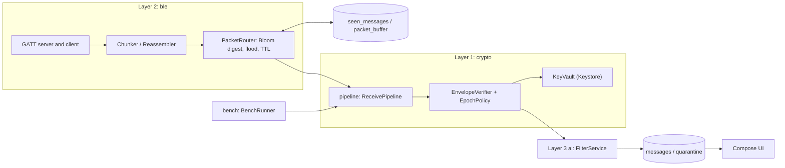
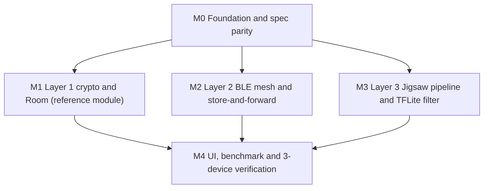

# P2Chat: Implementation Plan

| | |
|---|---|
| Status | v1 complete (§1–7, milestones M0–M4), 2026-10-18 |
| Team | TEAM-1, four developers, all using coding agents (Antigravity and Claude Code) |
| Deadline | None set. Milestones with exit checks. (Course evaluation date: add under §7 when known.) |
| Related | [`PRD.md`](PRD.md), [`../AGENTS.md`](../AGENTS.md) |

## Contents
1. How to use this plan
2. Decisions log
3. Architecture
4. Data model
5. Milestones
6. Tasks (M0–M4)
7. Risks and open items

---

## 1. How to use this plan

- **Each task (`T1.5`) becomes one issue and, ideally, one PR.** Its body can be handed to an agent as-is.
- Every task lists:
  - **Lane / Owner** and **Depends on**: who builds it and what must be merged first.
  - **Covers:** PRD requirement IDs.
  - **Touches:** files and folders it may change. Anything outside needs a reason in the PR.
  - **Do:** what to build.
  - **Done when:** acceptance checks. The verify command must also pass.
  - **Not in this task:** what to leave alone.
- Within a module, the schema/data task comes first; screens follow.
- When a decision changes, update §2 and the PRD in the same PR.
- **Environment:** Windows, PowerShell. Use `.\gradlew.bat` for Android and `uv run python …` for scripts. Never use bash-only commands.
- **Verify command:** `.\scripts\verify.ps1` (created in T0.6). Until T0.6 merges, the verify command is the Gradle unit-test task (`.\gradlew.bat testDebugUnitTest`, `TODO: confirm task names in T0.2`).
- **Path conventions (proposed, confirmed in T0.2):**
  - `<pkg>` is the app's Kotlin package: `TODO: confirm after scaffold`.
  - Kotlin source is `app/src/main/java/<pkg>/`, unit tests `app/src/test/java/<pkg>/`, device tests `app/src/androidTest/java/<pkg>/`.
  - Proposed sub-packages: `wire`, `crypto`, `data`, `ble`, `ai`, `pipeline`, `ui`, `bench`.
  - `BleConstants.kt` already exists; its path is `TODO: confirm in T0.1`.
  - Assets live in `app/src/main/assets/` (given in the PRD).

---

## 2. Decisions log

| # | Area | Decision |
|---|---|---|
| 1 | Lanes | Lane 1 Sibi (crypto, Keystore, rotation); Lane 2 Aditya (BLE, chunking, Bloom, routing); Lane 3 Krishiv (Jigsaw pipeline, tokenizer, TFLite); Lane 4 Siddharth (Compose UI, Room, benchmark). PRD D-14. |
| 2 | Wire contract | `BleConstants.kt` and `scripts/wire_spec.py` are the two copies of one contract, kept equal by `scripts/check_wire_parity.py` in the verify gate. PRD D-1. |
| 3 | Frame layout | `packet_type` is in the header and AAD; ECDSA signature is raw 64 bytes; `ttl` is outside AAD and signature; CHAT frame = 24 B header + 12 B nonce + 16 B tag + 4 B length + 358 B ciphertext + 64 B signature = 478 B. PRD SEC-4/5/6/19. |
| 4 | Inner payload | `sent_at (8B BE int64 ms) + UTF-8 bytes`; Python generator updated in T0.3. PRD D-5. |
| 5 | Crypto providers | P-256 ECDH/ECDSA via JCA/BouncyCastle at `minSdk = 26`; Keystore AES-256-GCM master key wraps private keys; Keystore ECDH allowed on API 31+ behind one interface. Reason: one code path to test against the Python vectors. |
| 6 | Pairwise key transport | Pairwise secrets come from ECDH public keys exchanged by QR (invite) and the admin-signed roster; no over-the-air handshake. PRD D-15 (approved). |
| 7 | Digest | Bloom filter, 1,200 B, k = 7, double hashing from `msg_id`. PRD D-3. |
| 8 | Dedup | Relay dedup by `msg_id`; a member evicts a `msg_id` whose packet fails signature or GCM so the genuine packet is still accepted. PRD D-6. |
| 9 | Latency | `BENCH_ACK` RTT / 2 on the sender's monotonic clock plus hop count. PRD D-7. |
| 10 | At-rest | One Room `TypeConverter`, `LocalAtRestCipher`, key alias `p2chat_room_master_key`. A second Keystore alias (proposed name `p2chat_identity_wrap_key`) wraps identity and group keys so a failure in one does not corrupt the other. |
| 11 | Model | Quantized `all-MiniLM-L6-v2`, 384-d. PRD D-2. |
| 12 | Blocklist | Shares τ_warn/τ_block; per-vector `force_quarantine` (default on) triggers Tier 1 at ≥ 0.80. PRD D-11. |
| 13 | Settings storage | Thresholds and flags live in a Room `settings` table, not DataStore, to avoid a new dependency. |
| 14 | Test strategy | Pure logic is JVM unit-tested. Anything needing Keystore, Room or BLE runs as `androidTest` on a physical device (Device A). No Robolectric. |
| 15 | Parallelism | After M0, M1 (Lane 1 + Lane 4), M2 (Lane 2) and M3 (Lane 3) run in parallel. M4 integrates. Reason: the wire contract is frozen in M0, so lanes only meet through byte arrays and verdict types. |
| 16 | Reference module | M1 is the reference module. `T1.14` (Onboarding) is the vertical slice every later screen copies: entity → DAO → repository → ViewModel → screen → test. |
| 17 | Dependencies | No new library beyond PRD §9 without asking. Approved for T1.14: `com.google.zxing:core` and AndroidX CameraX (`camera-camera2`, `camera-lifecycle`, `camera-view`), no Google Play Services. PRD D-16. |
| 18 | Transport framing | Use the framing in `docs/WIRE_SPEC.md`; if the contract defines none, add a 4-byte transport header (`kind`, `frame_id`, `chunk_index`, `chunk_count`) through the T0.1 contract-change procedure. A 478 B CHAT frame plus 4 B is still one write at MTU 517. PRD D-17 (approved). |
| 19 | Centroid source | Centroids are built with the shipped quantized `.tflite`, not the float model, so on-device scores match calibration. PRD D-18 (approved). |
| 20 | Asset sidecar | `toxic_vectors_meta.json` carries one category label per vector because the flat `.bin` has none; it feeds the top-3 categories in the test bench (AI-17). |
| 21 | Normalizer rules | Collapse repeats to 2 and substitute symbols only with a letter on both sides, so `good` is not `god` and `stop!` is not `stopi`. PRD AI-2. |
| 22 | Debug tooling | A debug-only mesh screen and peer allowlist live in `app/src/debug/` and are excluded from release builds. They are test aids, not PRD screens. |
| 23 | Dataset handling | The Jigsaw dataset is never committed (source and licence `TODO: confirm`); scripts take a path argument and the path is git-ignored. |
| 24 | Python toolchain | `tensorflow-cpu` installed with `uv` on Python 3.11 or 3.12 (Windows x64) is the primary route for model conversion and the offline interpreter (`tf.lite.Interpreter`); standalone `tflite-runtime` is not used because its wheels frequently lack native Windows builds. |
| 25 | Load balancing | Sibi co-owns T3.11 and T3.12 once M1 merges. In M4: Aditya owns the Radar screen, Krishiv the AI Filter screen, Sibi the benchmark engine; Lane 4 keeps the other screens and the benchmark screen. |

---

## 3. Architecture

Component names below are **proposed**; T0.2 and T0.4 confirm them.

### How an incoming packet flows

1. GATT writes arrive and the reassembler rebuilds one frame (at most 1,024 bytes).
2. `WireCodec` parses the header; a malformed frame, `ttl` 0 or `ttl` above 15 is dropped (`DROP_MALFORMED`, `DROP_TTL`).
3. `PacketRouter` checks the 2,048-entry LRU then `seen_messages`; a known `msg_id` is dropped (`DROP_DUPLICATE`).
4. The router stores the frame in `packet_buffer`, records `msg_id`, and forwards it with `ttl - 1` to every connected peer except the source when `ttl > 1`.
5. If this device is not a member of `group_id`, processing ends (`NOT_MEMBER_OPAQUE`).
6. `EpochPolicy` picks the key for `key_epoch`: current, previous within grace, or hold for a future epoch (`HOLD_FUTURE_EPOCH`, `DROP_EPOCH_EXPIRED`).
7. `EnvelopeVerifier` checks the roster, revoked list and ECDSA signature, then opens AES-256-GCM with the AAD (`DROP_UNKNOWN_SENDER`, `DROP_REVOKED_SENDER`, `DROP_BAD_SIGNATURE`, `DROP_AUTH_FAIL`). On failure it evicts the `msg_id` (decision 8).
8. The inner payload is split into `sent_at` and text; stale or future timestamps are dropped (`DROP_STALE`).
9. `FilterService` scores the text once and returns Tier 1, 2 or 3 (`ACCEPT` with a tier).
10. The message (or quarantine row) is written to Room with the body encrypted at rest; the UI observes Room.

Control packets (`KEY_ROTATE`, `ROSTER_SYNC`, `PAIRWISE_INVITE`) use steps 1–7 and are handled by their services instead of steps 8–10. Benchmark packets (`BENCH_DATA`, `BENCH_ACK`) never reach step 9.

### Shared helpers and result codes

- `PacketVerdict` (sealed): `ACCEPT`, `DROP_MALFORMED`, `DROP_TTL`, `DROP_DUPLICATE`, `NOT_MEMBER_OPAQUE`, `HOLD_FUTURE_EPOCH`, `DROP_EPOCH_EXPIRED`, `DROP_UNKNOWN_SENDER`, `DROP_REVOKED_SENDER`, `DROP_BAD_SIGNATURE`, `DROP_AUTH_FAIL`, `DROP_STALE`. Every drop is silent on the air (no reply packet) and counted locally.
- `WireError` (codec level): truncated frame, length overrun, unknown packet type, `ttl` out of range.
- `Clock` interface injected everywhere time matters, so grace and expiry are testable.
- `SecureLog`: the only allowed logging entry point; never logs bytes or plaintext.
- `MessageLimits`: 350-byte plaintext, 358-byte inner payload, 512-byte GATT write target, 1,024-byte frame cap, 16-member roster cap.

---

## 4. Data model

One Room database (`AppDatabase`). Columns shown are the key ones; exact types are fixed in the task that creates the table. Private keys and group keys are stored only as wrapped blobs.

### Mesh storage (T1.1, read by Layer 2)

| Table | Key columns | Read | Write |
|---|---|---|---|
| `seen_messages` | `msg_id` (8 B, PK), `first_seen_ms` | `PacketRouter` through `SeenDao` | Router on first receipt; eviction on verify failure (decision 8); purge after 7 days |
| `packet_buffer` | `msg_id` (PK), `group_id`, `packet_type`, `frame` (BLOB), `received_ttl`, `stored_at_ms`, `expires_at_ms`, `priority` | Digest builder, peer sender, `RotationService` | Router; evictor (cap 1,000 or 48 h, control packets rank higher) |

### Identity and groups (T1.2, read by Layer 1)

| Table | Key columns | Read | Write |
|---|---|---|---|
| `local_identity` | alias, `sender_fp`, signing pub, ECDH pub, wrapped signing priv, wrapped ECDH priv | `KeyVault`, Onboarding | `IdentityManager` once at first launch; alias edit |
| `peers` | `sender_fp` (PK), signing pub, ECDH pub, alias, `verified`, `first_seen_ms` | Verifier, Chat UI | `PeerPinning` (TOFU); a changed key is rejected, never overwritten |
| `groups` | `group_id` (PK), name, my role, `current_epoch`, wrapped current key, `prev_epoch`, wrapped prev key, `grace_expires_ms`, `roster_version` | `EpochPolicy`, `EnvelopeVerifier`, UI | `GroupManager`, `RotationService` |
| `roster_members` | (`group_id`, `sender_fp`) PK, signing pub, ECDH pub, alias, `revoked` | Verifier, Admin screen | `GroupManager` after a valid admin-signed roster only |
| `settings` | `key` (PK), `value` | `FilterSettings`, UI | UI through `SettingsRepository` |

### Messages (T1.3, read by UI)

| Table | Key columns | Read | Write |
|---|---|---|---|
| `messages` | `msg_id` (PK), `group_id`, `sender_fp`, `key_epoch`, `sent_at_ms`, `received_at_ms`, `body` (at-rest encrypted), `sig_ok`, `tier`, `score`, `revealed` | Chat UI via Flow | `ReceivePipeline` only; `revealed` by UI |

### Created later

| Table | Milestone | Note |
|---|---|---|
| `quarantine`, `user_blocked_vectors` | M3 (Lane 3) | Schema-first task at the start of M3 |
| `bench_runs`, `bench_samples` | M4 (Lane 4) | Schema-first task at the start of M4 |

No table is readable by another app or by the network. The only way a row leaves the device is the benchmark CSV export (PRD BENCH-3), which contains no message text.

---

## 5. Milestones

| Milestone | Delivers | Exit check |
|---|---|---|
| **M0 Foundation and spec parity** | Frozen wire contract with parity script, Python vector generator, Kotlin wire codec, app shell, verify gate, README | On a clean checkout in PowerShell: `.\scripts\verify.ps1` passes, including a Kotlin test that decodes every Python-generated vector; the app installs on Device A and shows the four-tab dark shell |
| **M1 Layer 1 crypto and Room (reference module)** | Room data layer, Keystore identity, crypto primitives, envelope seal/open, groups, roster, invite, rotation, security suite, Onboarding | `.\scripts\verify.ps1` passes with cross-language vectors in both directions and the 40+ case rejection suite; a 4-node in-memory simulation shows a removed member cannot read epoch 2; on Device A onboarding completes and the raw DB file contains no plaintext marker |
| **M2 Layer 2 BLE mesh and store-and-forward** | Dual-role BLE, MTU/chunking, Bloom digest, flood, TTL, buffer, dedup, foreground service, fuzz test | Two physical devices exchange a frame in both directions; a three-device line delivers a TTL 2 packet from A to C through B |
| **M3 Layer 3 Jigsaw pipeline and TFLite filter** | `toxic_vectors.bin`, calibration report, WordPiece, normalizer, TFLite scorer, tiers, quarantine, Block Similar storage | Calibration meets D-9; the on-device `FilterBenchmarkTest` prints score, top-3 categories and latency on Device A with p95 under 35 ms |
| **M4 UI, benchmark and 3-device verification** | Receive pipeline integration, remaining screens, benchmark mode, hardware runs | The live three-device demo meets the PRD §8 bars and exports a CSV |

All five milestones are detailed in §6.

### Running work in parallel

| Lane (owner) | M0 | M1 | M2 | M3 | M4 |
|---|---|---|---|---|---|
| 1 Crypto (Sibi) | T0.1, T0.3 | T1.4–T1.13 | support integration | co-owns T3.11, T3.12 after M1 | T4.2, T4.3, T4.9, T4.14 |
| 2 BLE (Aditya) | T0.2, T0.4 | starts M2 after M0 | all of M2 | | T4.7, T4.12, T4.13 |
| 3 AI (Krishiv) | T0.6 | starts M3 after M0 | | all of M3 | T4.8 |
| 4 UI and Room (Siddharth) | T0.5, T0.7 | T1.1–T1.3, T1.14 | | | T4.1, T4.4, T4.5, T4.6, T4.10, T4.11 |

Rule of thumb: Sibi, Aditya and Krishiv all start their big milestone the day M0 merges. Siddharth's M1 tasks (T1.1–T1.3) are the first thing to merge because Lane 1 depends on those tables.

### Requirement coverage plan

| Requirement IDs | Milestone |
|---|---|
| SEC-4, SEC-5 (layout), NET-1 (constants), UI-6/UI-7 (conventions) | M0 |
| ID-1..5, SEC-1..19, UI-1 | M1 |
| ID-6, NET-1..14 | M2 |
| AI-1..17 | M3 (AI-1 ordering finally enforced in M4) |
| UI-2..5, UI-6/UI-7 (final), BENCH-1..5 | M4 |

---

## 6. Tasks

### M0 Foundation and spec parity

#### T0.1 Freeze the wire contract
- **Lane / Owner:** 1 / Sibi (Aditya reviews). **Depends on:** nothing.
- **Covers:** SEC-4, SEC-5, SEC-6, NET-1, foundation
- **Touches:** `BleConstants.kt` (path `TODO: confirm`), `scripts/wire_spec.py`, `scripts/check_wire_parity.py` (new), `docs/WIRE_SPEC.md` (new), `docs/PRD.md` (remove D-1 TODOs only)
- **Do:**
  1. Read `BleConstants.kt` and the Python reference; table every UUID string, header field and order, HKDF salt/info string, fingerprint derivation and initial epoch.
  2. Where a value is missing from one or both files, apply the PRD D-1 defaults and write it into both files.
  3. Write `docs/WIRE_SPEC.md` with byte-offset tables for the CHAT frame, core blob (`nonce 12 + tag 16 + ciphertext_len 4 BE + ciphertext`), signature (64 B), and each control packet type, plus the six packet-type codes.
  4. Write `scripts/check_wire_parity.py` that parses constants from both files and exits non-zero on any difference.
  5. Replace the D-1 `TODO: confirm` markers in the PRD with the confirmed values.
- **Done when:** `uv run python scripts/check_wire_parity.py` exits 0; changing one character of one UUID in either file makes it exit non-zero (shown in the PR); `docs/WIRE_SPEC.md` shows a worked CHAT frame totalling 478 bytes; the PRD has no remaining D-1 TODO.
- **Not in this task:** any crypto code, any Kotlin beyond constants, changing the contract's meaning without a PRD update.

#### T0.2 Audit and pin the Android toolchain
- **Lane / Owner:** 2 / Aditya. **Depends on:** nothing.
- **Covers:** foundation
- **Touches:** Gradle build files and version catalog (paths `TODO: confirm`), `docs/TOOLCHAIN.md` (new)
- **Do:**
  1. Record the real package name, module name, AGP, Kotlin, Compose, Room, TFLite and BouncyCastle versions from the existing 20% port.
  2. Set `minSdk = 26`; add only the PRD §9 dependencies that are missing (Room, TFLite, BouncyCastle, JUnit, Compose M3); ask before adding anything else.
  3. Record the real Gradle task names for build, unit test, device test and lint.
  4. Write everything into `docs/TOOLCHAIN.md` (this feeds AGENTS.md later).
- **Done when:** in a fresh PowerShell session `.\gradlew.bat` build and unit-test tasks succeed; the app installs on Device A; every version in `docs/TOOLCHAIN.md` matches the build files.
- **Not in this task:** feature code, BLE code, new libraries outside PRD §9.

#### T0.3 Python tooling and test-vector generator
- **Lane / Owner:** 1 / Sibi. **Depends on:** T0.1.
- **Covers:** SEC-4, SEC-5, SEC-14, SEC-17 (Python side)
- **Touches:** `pyproject.toml` (`TODO` if one exists), `scripts/gen_test_vectors.py` (new), `app/src/test/resources/vectors/crypto_vectors.json` (new, generated), `scripts/` tests (`TODO: confirm runner`)
- **Do:**
  1. Set up the `uv` project with `pycryptodome`, pinning `requires-python` to 3.11–3.12 (Windows x64) so the `tensorflow-cpu` install in T3.2 works.
  2. Update the Python reference to the D-5 inner payload (`sent_at` + UTF-8 bytes) and `packet_type` in the AAD.
  3. Generate deterministic vectors from fixed seeds: at least 20 positive (empty text, 1 byte, 350 bytes, multi-byte UTF-8, each packet type) and at least 10 negative (tampered ciphertext, tag, nonce, each AAD field, signature, wrong epoch).
  4. Each vector stores keys, header fields, expected frame hex and the expected verdict name from §3.
  5. Add a Python self-check that verifies every vector.
- **Done when:** `uv run python scripts/gen_test_vectors.py` run twice yields byte-identical JSON; the self-check passes; the file holds at least 20 positive and 10 negative vectors.
- **Not in this task:** Kotlin code, BLE, tokenizer fixtures (M3).

#### T0.4 Kotlin wire codec
- **Lane / Owner:** 2 / Aditya. **Depends on:** T0.1, T0.3.
- **Covers:** SEC-4, SEC-5 (layout), NET-7 (range checks)
- **Touches:** `app/src/main/java/<pkg>/wire/` (about 5 files: `PacketType`, `PacketHeader`, `CoreBlob`, `WireError`, `WireCodec`), matching tests under `app/src/test/java/<pkg>/wire/`
- **Do:**
  1. Encode and decode the header, core blob and signature split, big-endian, per `docs/WIRE_SPEC.md`.
  2. Return typed `WireError` for truncated frames, a length field larger than the remaining bytes, unknown packet type and `ttl` of 0 or above 15.
  3. No cryptography here; ciphertext stays opaque bytes.
- **Done when:** a JUnit test decodes every vector's frame into fields equal to the JSON; `decode(encode(x)) == x` for all vectors; 1,000 random byte strings produce a `WireError` and never an uncaught exception; a 350-byte CHAT frame measures exactly 478 bytes.
- **Not in this task:** encryption, signatures, BLE, Room.

#### T0.5 App shell, theme and UI conventions
- **Lane / Owner:** 4 / Siddharth. **Depends on:** T0.2.
- **Covers:** UI-6, UI-7 (conventions), foundation
- **Touches:** `<pkg>/ui/theme/`, `<pkg>/ui/nav/`, `<pkg>/ui/common/`, the main Activity (`TODO: confirm path`)
- **Do:** Material 3 dark theme; bottom navigation with four placeholder screens (Chats, Radar, AI Filter, Bench); shared `EmptyState`, `LoadingState` and `ErrorState` composables; content descriptions on every navigation item and primary button.
- **Done when:** on Device A the app opens on Chats and all four tabs open; the layout is checked at 360 dp width; a Compose UI test asserts each tab has a content description; the verify command passes.
- **Not in this task:** real screen content, ViewModels, Room, BLE permissions.

#### T0.6 Pre-push verify gate
- **Lane / Owner:** 3 / Krishiv. **Depends on:** T0.1, T0.2, T0.3.
- **Covers:** foundation
- **Touches:** `scripts/verify.ps1` (new), `scripts/check_asset_size.py` (new)
- **Do:**
  1. `verify.ps1` runs, in order: wire parity script, vector regeneration with a check that the committed JSON is unchanged, Kotlin unit tests, lint (`TODO: confirm task`), asset-size check.
  2. The asset check sums `.tflite`, `vocab.txt` and `toxic_vectors.bin` when present and fails above 30 MB; it passes with a notice when they are not yet present.
  3. Exit non-zero on the first failing step, with a clear message.
- **Done when:** `.\scripts\verify.ps1` exits 0 on a clean checkout; deliberately editing one vector makes it exit non-zero (shown in the PR).
- **Not in this task:** CI service setup, Kotlin feature code.

#### T0.7 README and onboarding docs
- **Lane / Owner:** 4 / Siddharth. **Depends on:** T0.2, T0.6.
- **Covers:** foundation
- **Touches:** `README.md`, `docs/TOOLCHAIN.md` (link only)
- **Do:** README with what P2Chat is, the PowerShell setup steps copied from `docs/TOOLCHAIN.md`, how to run the verify gate, the lane table, and links to the PRD and this plan.
- **Done when:** a team member who did not write it follows the README on a clean Windows machine and gets a passing verify run and an installed app; every command in the README was run.
- **Not in this task:** AGENTS.md, CLAUDE.md, feature documentation.

### M1 Layer 1 crypto and Room data layer (reference module)

Several M1 tasks run in parallel: Lane 4 does T1.1–T1.3 first; Lane 1 starts T1.5 immediately (it needs no tables) and T1.4 once T1.2 merges.

#### T1.1 Room base and mesh tables
- **Lane / Owner:** 4 / Siddharth. **Depends on:** T0.2.
- **Covers:** NET-8, NET-9 (storage only)
- **Touches:** `<pkg>/data/db/AppDatabase.kt`, `<pkg>/data/mesh/` (`SeenMessage`, `BufferedPacket`, two DAOs), tests under `app/src/androidTest/`, exported schema folder (`TODO: confirm path`)
- **Do:** Room database v1 with `seen_messages` and `packet_buffer` per §4. DAO functions: `insertIfAbsent`, `delete`, `purgeExpired` (7 days seen, 48 h buffer), `countBuffer`, `allMsgIds`. Enable schema export and a migration test harness.
- **Done when:** device tests on Device A show a duplicate `insertIfAbsent` returns false, `purgeExpired` removes only expired rows, and `allMsgIds` returns every stored id; the exported schema file is committed; the verify command passes.
- **Not in this task:** routing, Bloom filter, eviction policy, any other table.

#### T1.2 Identity, peer, group and roster tables
- **Lane / Owner:** 4 / Siddharth. **Depends on:** T1.1.
- **Covers:** SEC-8, SEC-10 (storage), ID-5 (peer pinning storage)
- **Touches:** `<pkg>/data/identity/` and `<pkg>/data/group/` (`LocalIdentity`, `Peer`, `GroupEntity`, `RosterMember`, `Setting` plus DAOs, at most 10 files), tests, schema export
- **Do:** create `local_identity`, `peers`, `groups`, `roster_members`, `settings` per §4 with unique keys (`sender_fp`; `group_id, sender_fp`). Key blobs are opaque wrapped bytes here; no crypto logic. A DAO call that would change a stored peer key returns a conflict result instead of overwriting.
- **Done when:** device tests show the unique constraints hold, a peer-key change returns the conflict result, and roster rows for two groups stay separate; schema export updated; verify passes.
- **Not in this task:** key wrapping, signature checks, rotation logic.

#### T1.3 Messages table and at-rest cipher
- **Lane / Owner:** 4 / Siddharth. **Depends on:** T1.1.
- **Covers:** SEC-15
- **Touches:** `<pkg>/data/message/` (`MessageEntity`, `MessageDao`, `LocalAtRestCipher`), tests
- **Do:** create `messages` per §4. `LocalAtRestCipher` is a Room `TypeConverter` using an Android Keystore AES-256-GCM key (alias `p2chat_room_master_key`) with a fresh random IV per value, stored as `iv + ciphertext + tag`. A decryption failure returns a typed error, never a crash.
- **Done when:** a device test writes a body containing a known marker string, reads the raw database file bytes, and finds no marker; two identical bodies produce different stored bytes; read-back equals the original; a corrupted stored value yields the typed error.
- **Not in this task:** searching message content, other tables, UI.

#### T1.4 Key vault and identity generation
- **Lane / Owner:** 1 / Sibi. **Depends on:** T1.2.
- **Covers:** ID-1, ID-2, SEC-1
- **Touches:** `<pkg>/crypto/keys/` (`KeyVault`, `IdentityManager`, `EcProvider`), tests
- **Do:**
  1. Create the Keystore AES-256-GCM wrapping key (proposed alias `p2chat_identity_wrap_key`).
  2. Generate separate P-256 ECDH and ECDSA keypairs through the JCA/BouncyCastle provider; wrap the private keys and store them in `local_identity`.
  3. Define one `EcProvider` interface with a software implementation and an API 31+ Keystore ECDH implementation; a `forceSoftwareEcdh` flag lets Device A test the `minSdk = 26` path.
  4. `sender_fp` = first 8 bytes of SHA-256 of the 65-byte uncompressed signing public key.
- **Done when:** the fingerprint for a fixed test key equals the Python vector value; a device test confirms the stored private-key blob does not parse as an EC key without unwrapping; the same identity (same `sender_fp`) loads after an app restart; both provider paths give the same shared secret for the same inputs.
- **Not in this task:** AES-GCM, signatures, groups, UI.

#### T1.5 Crypto primitives
- **Lane / Owner:** 1 / Sibi. **Depends on:** T0.3, T0.4.
- **Covers:** SEC-2, SEC-3, SEC-4, SEC-6
- **Touches:** `<pkg>/crypto/prim/` (`AesGcm`, `Hkdf`, `Ecdh`, `Ecdsa`), tests
- **Do:** AES-256-GCM seal/open with AAD and a 12-byte `SecureRandom` nonce; HKDF-SHA256; ECDH on P-256; ECDSA sign/verify with raw 64-byte (r, s) conversion to and from DER. All outputs are byte arrays in the wire layout.
- **Done when:** JUnit reproduces the Python vectors for ECDH shared secret, HKDF output and GCM ciphertext; Python-made ECDSA signatures verify; 10,000 seals produce no repeated nonce; a wrong key, wrong tag or wrong AAD returns a typed error.
- **Not in this task:** packet assembly, groups, persistence.

#### T1.6 Envelope seal and open
- **Lane / Owner:** 1 / Sibi. **Depends on:** T1.5.
- **Covers:** SEC-3, SEC-4, SEC-5, SEC-6, SEC-14, SEC-19
- **Touches:** `<pkg>/crypto/envelope/` (`EnvelopeBuilder`, `EnvelopeVerifier`, `PacketVerdict`, `MessageLimits`), tests
- **Do:** build a CHAT packet (header, `sent_at` + text, seal, sign over AAD fields and core blob, `ttl` excluded). Verify in the order signature first, then decrypt, then timestamp check, returning a `PacketVerdict`. `MessageLimits` enforces 350 bytes at the composer boundary.
- **Done when:** every positive vector from T0.3 verifies and decrypts; Kotlin-built frames verify again after changing only the `ttl` byte; every negative vector returns its expected verdict; a 351-byte message is rejected before sealing; `sent_at` 48 h + 1 s old and 5 min + 1 s in the future return `DROP_STALE`.
- **Not in this task:** keys from the database, epochs, groups, BLE.

#### T1.7 Cross-language parity in both directions
- **Lane / Owner:** 1 / Sibi. **Depends on:** T1.6, T0.6.
- **Covers:** SEC-17
- **Touches:** `app/src/test/java/<pkg>/crypto/`, `scripts/verify_kotlin_vectors.py` (new), `scripts/verify.ps1` (add one step)
- **Do:** a Kotlin test writes at least 20 vectors (same categories as T0.3) to a build output file; the Python script verifies them with `pycryptodome`; `verify.ps1` runs both directions.
- **Done when:** the verify command runs both directions with at least 20 vectors each and exits 0; flipping one byte of the Kotlin output makes the Python step fail.
- **Not in this task:** new vector categories, group logic.

#### T1.8 Group lifecycle and roster
- **Lane / Owner:** 1 / Sibi. **Depends on:** T1.2, T1.6.
- **Covers:** SEC-8, SEC-10
- **Touches:** `<pkg>/crypto/group/` (`GroupManager`, `RosterCodec`, `RosterVerifier`), tests
- **Do:** create a group (random 4-byte `group_id`, 256-bit key, `key_epoch = 1`, roster version 1 signed by the admin); build and parse `ROSTER_SYNC`; accept a roster only with a higher version and a valid admin signature; enforce 16 members.
- **Done when:** tests show a lower-version roster is rejected, a forged roster is rejected, a 17th member is rejected, and the group key is stored only as a wrapped blob.
- **Not in this task:** invites, rotation, UI.

#### T1.9 Invite, QR payload and pairwise channel
- **Lane / Owner:** 1 / Sibi. **Depends on:** T1.4, T1.5, T1.8.
- **Covers:** ID-4, ID-5, SEC-2, SEC-7, SEC-9
- **Touches:** `<pkg>/crypto/invite/` (`QrPayloadCodec`, `PairwiseChannel`, `InviteService`, `PeerPinning`), tests
- **Do:** QR payload = signing public key + ECDH public key + alias (at most 32 chars); `PairwiseChannel` derives the secret and seals/opens control packets; `InviteService` builds `PAIRWISE_INVITE` (group key, epoch, signed roster) for an invitee; `PeerPinning` applies trust-on-first-use and returns `PEER_KEY_CHANGED` when a known `sender_fp` shows a different key.
- **Done when:** a QR payload round-trips and its size is recorded in the PR; a sealed invite opens only with the invitee's key; a changed key for a pinned fingerprint is rejected.
- **Not in this task:** camera scanning, UI, rotation.

#### T1.10 Epoch policy (pure logic)
- **Lane / Owner:** 1 / Sibi. **Depends on:** T1.6.
- **Covers:** SEC-12, SEC-13
- **Touches:** `<pkg>/crypto/epoch/` (`EpochPolicy`, `EpochState`, `Clock`), tests
- **Do:** implement the PRD §5.2.1 state machine as pure functions with an injected `Clock`: current key, previous key valid for 10 minutes from rotation, immediate drop for revoked senders, hold for a future epoch up to 48 h, drop once the previous epoch expires.
- **Done when:** fake-clock tests cover: accepted at 9 min 59 s and rejected at 10 min 1 s after rotation; a revoked sender dropped at second 0; a future-epoch packet held then released; a held packet expiring after 48 h; every state transition in the diagram exercised at least once.
- **Not in this task:** disk I/O, packet building, UI.

#### T1.11 Rotation service
- **Lane / Owner:** 1 / Sibi. **Depends on:** T1.9, T1.10.
- **Covers:** SEC-7, SEC-11, SEC-12, SEC-13
- **Touches:** `<pkg>/crypto/rotation/` (`RotationService`, `KeyRotatePayload`), tests
- **Do:** admin removal increments `key_epoch`, generates a fresh key, adds the removed signing key to the revoked list, bumps the roster version, and creates one `KEY_ROTATE` per remaining member sealed under that member's pairwise secret, plus a `ROSTER_SYNC`. Members verify the admin signature, install the key, start the grace window and release held packets.
- **Done when:** an in-memory four-node simulation (admin, two members, one removed) shows the removed node cannot decrypt an epoch 2 message while the others can; the number of `KEY_ROTATE` packets equals members minus one; a held epoch 2 packet decrypts after the key arrives.
- **Not in this task:** transport, buffering, UI, admin transfer.

#### T1.12 Security invariant suite
- **Lane / Owner:** 1 / Sibi. **Depends on:** T1.11.
- **Covers:** SEC-18
- **Touches:** `app/src/test/java/<pkg>/crypto/security/` (one parameterized suite), `scripts/verify.ps1` (only if the suite is not already included)
- **Do:** one parameterized suite covering at least 40 cases: tampered ciphertext, tag, nonce; each AAD field (`packet_type`, `msg_id`, `group_id`, `sender_fp`, `key_epoch`); signature bit flip; wrong signer; revoked sender; old epoch after grace; replayed old `sent_at`; truncated frame. Unit tests for each part already exist in earlier tasks; this suite is the end-to-end invariant matrix the PRD requires.
- **Done when:** the suite reports 100% rejection and is included in the verify command.
- **Not in this task:** new production code, except fixes for bugs the suite finds.

#### T1.13 Secure logging guard
- **Lane / Owner:** 1 / Sibi. **Depends on:** T1.4.
- **Covers:** SEC-16
- **Touches:** `<pkg>/util/SecureLog.kt` (new, path `TODO` if a util package exists), `scripts/verify.ps1` (add a source check)
- **Do:** `SecureLog` accepts only tags and non-sensitive strings and refuses byte arrays; the verify gate fails on direct `Log.` or `println` use outside `SecureLog`.
- **Done when:** adding a `Log.d(` line in a scratch change makes verify fail; a logcat capture during the T1.14 flow contains none of the test key hex or marker plaintext.
- **Not in this task:** crash reporting, remote logging.

#### T1.14 Onboarding screen (vertical-slice reference)
- **Lane / Owner:** 4 / Siddharth. **Depends on:** T0.5, T1.4, T1.9.
- **Covers:** UI-1, ID-1, ID-3, ID-4, ID-5
- **Touches:** `<pkg>/ui/onboarding/` (`OnboardingViewModel`, `OnboardingScreen`, `QrScannerScreen`), `<pkg>/ui/nav/` (first-launch gate), dependency file (adds `com.google.zxing:core` and CameraX `camera-camera2`, `camera-lifecycle`, `camera-view`, approved in PRD D-16; versions `TODO: confirm in T0.2`), AndroidManifest (camera permission), tests
- **Do:** first-launch gate that blocks other screens; alias entry (1–32 characters, validated); key generation with a loading state; fingerprint in hex and a QR code; scan another device's QR with CameraX and ZXing `MultiFormatReader` (fully offline, no Google Play Services) to mark it verified or show a key-changed warning; request the camera permission with a clear denied state; empty and error states. This task is the pattern later screens copy: entity, DAO, repository, ViewModel, screen, test.
- **Done when:** on Device A a fresh install shows only onboarding; a 33-character alias is rejected; the displayed fingerprint matches the value the T1.4 test prints; scanning a second device's QR shows a verified badge; relaunch skips onboarding; the raw database file contains no plaintext marker; the verify command passes.
- **Not in this task:** BLE permissions, group screens, benchmark.

#### M1 exit check
`.\scripts\verify.ps1` passes with cross-language vectors in both directions and the security suite at 100%; the four-node rotation simulation passes; on Device A onboarding completes and the raw database file has no plaintext marker.

---

### M2 Layer 2 BLE GATT mesh and store-and-forward engine

Lane 2 (Aditya) owns M2. It needs only M0 (wire contract and codec) and the T1.1 mesh tables, so it runs in parallel with M1 and M3. Pure logic (framing, Bloom, routing, buffer, sync) is built and tested on the JVM first; Android Bluetooth classes come after. Hardware tasks use Device A plus a second team handset.

#### T2.1 BLE availability and permissions state
- **Lane / Owner:** 2 / Aditya. **Depends on:** T0.2.
- **Covers:** ID-6, NET-1 (prerequisite)
- **Touches:** AndroidManifest (`TODO: confirm path`), `<pkg>/ble/state/` (`BleAvailability`, `BleState`), tests
- **Do:**
  1. Declare the Bluetooth permissions required for the project's `targetSdk` (Android 12+ uses scan, advertise and connect permissions; older versions use legacy Bluetooth and location permissions; exact set `TODO: confirm in T0.2`).
  2. Expose `StateFlow<BleState>` with `READY`, `BLUETOOTH_OFF`, `PERMISSION_DENIED`, `PERMISSION_DENIED_PERMANENTLY`, `ADVERTISING_UNSUPPORTED`, `NO_BLE`.
  3. Emit fix actions (open Bluetooth settings, request permission, open app settings) as one-shot events for the UI to consume later.
- **Done when:** on Device A turning Bluetooth off and on moves the state `READY` → `BLUETOOTH_OFF` → `READY` within 2 s (assumption); revoking a permission in system settings moves it to a denied state; a unit test covers every state transition.
- **Not in this task:** any screen, scanning, advertising.

#### T2.2 Transport framing, chunker and reassembler
- **Lane / Owner:** 2 / Aditya. **Depends on:** T0.1, T0.4.
- **Covers:** NET-4, NET-12 (reassembly bounds)
- **Touches:** `<pkg>/ble/framing/` (`TransportFrame`, `Chunker`, `Reassembler`); only if the contract defines no framing: `docs/WIRE_SPEC.md`, `scripts/wire_spec.py`, `BleConstants.kt`, `scripts/check_wire_parity.py`
- **Do:**
  1. Use the framing in `docs/WIRE_SPEC.md`. If none exists, add a 4-byte transport header `kind (1B: 0 PACKET, 1 DIGEST) + frame_id (1B) + chunk_index (1B) + chunk_count (1B)` to both contract files and the parity script, and update the PRD, in the same PR (PRD D-17).
  2. The chunker splits a frame into pieces of at most `MTU − 3 − header` bytes; the reassembler keeps one state per connection and `frame_id`, discards a frame after 5 s of inactivity, and rejects any frame declaring more than 1,024 bytes.
  3. Pure Kotlin, no Android classes.
- **Done when:** for MTU 23, 100, 185 and 517 and every frame size from 1 to 1,024 bytes, `reassemble(chunk(f)) == f`; a 350-byte-text CHAT frame (478 B) is exactly one write at MTU 517; a partial frame is dropped after 5 s on a fake clock; an oversize declaration is dropped; two connections with the same `frame_id` never mix.
- **Not in this task:** GATT calls, digests, routing.

#### T2.3 Bloom digest
- **Lane / Owner:** 2 / Aditya. **Depends on:** T0.1.
- **Covers:** NET-5
- **Touches:** `<pkg>/ble/digest/BloomDigest.kt`, `scripts/wire_spec.py` (add the reference function), `scripts/check_wire_parity.py` (if constants are added), `app/src/test/resources/vectors/bloom_vectors.json` (new, generated), tests
- **Do:**
  1. Use the Bloom definition in the contract if present. Otherwise define it in `scripts/wire_spec.py` and `BleConstants.kt`: 9,600 bits, k = 7, index `i` = `(h1 + i × h2) mod 9,600` with `h1` and `h2` the low and high 32 bits of `msg_id` and `h2` forced odd; serialized as the raw 1,200 bytes.
  2. Implement `add`, `mightContain`, `toBytes`, `fromBytes` and `idsMissingFrom(peerDigest, myIds)`.
  3. The Python reference generates fixtures for 1,000 ids.
- **Done when:** Kotlin and Python produce byte-identical digests for the fixture ids; there are no false negatives; the measured false-positive rate over 100,000 absent ids is at most 1.5% (assumption; theory is about 0.8–1%); the serialized size is exactly 1,200 bytes.
- **Not in this task:** transport, buffers, sync.

#### T2.4 Packet router and dedup
- **Lane / Owner:** 2 / Aditya. **Depends on:** T0.4, T1.1.
- **Covers:** NET-6, NET-7, NET-9, NET-10
- **Touches:** `<pkg>/ble/routing/` (`PacketRouter`, `DedupCache`, `PeerSink`, `RouteDecision`), tests
- **Do:**
  1. Implement flow steps 2–4 of §3: parse, check `ttl` (0 or above 15 dropped), dedup (2,048-entry LRU in front of `seen_messages`), store, forward.
  2. Forward to every `PeerSink` except the source with `ttl − 1` only when `ttl > 1`.
  3. Pass every accepted frame to a `ReceivePipeline` interface (a stub in M2; the real one is built in M4).
  4. Relay regardless of any filter verdict: the router never sees the filter.
  5. Expose `evict(msgId)` for the D-6 rule.
- **Done when:** a JVM test with fake peers replays 1,000 packets, each delivered 3 times from 2 sources, and sees exactly one relay per packet per peer and exactly one pipeline call per packet; `ttl` 1 is delivered but not forwarded; `ttl` 0 and 16 are dropped; a forwarded frame equals the original except the `ttl` byte; evicting beyond 2,048 entries still dedups through Room; after `evict` the same `msg_id` is accepted again.
- **Not in this task:** Bluetooth classes, buffer eviction policy, crypto, filtering.

#### T2.5 Store-and-forward buffer and eviction
- **Lane / Owner:** 2 / Aditya. **Depends on:** T1.1, T2.4.
- **Covers:** NET-8, NET-11 (buffer side)
- **Touches:** `<pkg>/ble/buffer/` (`BufferManager`, `PriorityPolicy`), tests
- **Do:** cap 1,000 packets and 48 h. When full, evict expired packets first, then the oldest lowest-priority packet. Priority from high to low: `KEY_ROTATE`, `ROSTER_SYNC`, `PAIRWISE_INVITE`, `CHAT`, `BENCH_*` (benchmark lowest, assumption). Expose an occupancy `Flow` ("X / 1000"), `idsForDigest()` and `packetsMissingFrom(digest)`.
- **Done when:** tests show inserting a 1,001st chat packet evicts the oldest; 2,000 chat packets never evict a stored `KEY_ROTATE`; packets older than 48 h + 1 s on a fake clock are purged; benchmark packets are evicted before chat packets; occupancy never exceeds 1,000.
- **Not in this task:** transport, UI.

#### T2.6 GATT server
- **Lane / Owner:** 2 / Aditya. **Depends on:** T2.1, T2.2.
- **Covers:** NET-1, NET-3 (server side)
- **Touches:** `<pkg>/ble/gatt/` (`GattServerManager`, `GattProfile`), device tests
- **Do:** open a `BluetoothGattServer` exposing the service and characteristics defined in `BleConstants.kt` (`GattProfile` only references those constants); pass each write into that connection's `Reassembler`; send notifications through the `Chunker`; track connected centrals and MTU changes; hand all work off the Binder thread to a coroutine.
- **Done when:** a device test on Device A with Device B writing a 478-byte test frame delivers identical bytes to a test sink; a 1,024-byte frame written in chunks reassembles identically; notifications from A to B arrive in order for 100 frames.
- **Not in this task:** client role, scanning, advertising, routing.

#### T2.7 Advertiser and scanner
- **Lane / Owner:** 2 / Aditya. **Depends on:** T2.1.
- **Covers:** NET-1, NET-2 (scan filter)
- **Touches:** `<pkg>/ble/discovery/` (`MeshAdvertiser`, `MeshScanner`, `DiscoveredPeer`), tests
- **Do:** advertise the P2Chat service UUID; scan with a service-UUID filter; emit a `Flow<DiscoveredPeer>` with address, RSSI and last-seen time, de-duplicated; keep the scan mode in one constant (tuned in T2.13); make start and stop idempotent; map advertise failure codes into `BleState`.
- **Done when:** Device A and Device B each see the other within 10 s (assumption) with RSSI updates at least once per second in a `SecureLog` trace; a BLE device that does not advertise the UUID never appears; 20 start/stop cycles leave no live callbacks.
- **Not in this task:** connecting, GATT, UI.

#### T2.8 GATT client and connection manager
- **Lane / Owner:** 2 / Aditya. **Depends on:** T2.2, T2.7.
- **Covers:** NET-2, NET-3, NET-14
- **Touches:** `<pkg>/ble/gatt/` (`GattClientManager`, `ConnectionPool`, `WriteQueue`), device tests
- **Do:**
  1. Connect to discovered peers, at most 4 concurrent client connections; queue the rest.
  2. After connecting: discover services, call `requestMtu(517)`, and mark the link ready.
  3. Serialize all GATT operations through one `WriteQueue` per connection (Android permits one outstanding operation).
  4. On disconnect retry with exponential backoff capped at 30 s (assumption) without blocking the UI thread.
  5. Two devices may connect to each other in both roles at once; record this in the PR and handle duplicate links by BLE address (`TODO: confirm behaviour on device`).
- **Done when:** on Device A the granted MTU is logged for each peer (517 expected where supported); a fifth peer waits in the queue; stopping Device B's app triggers reconnect attempts at roughly 1, 2, 4, … up to 30 s; 100 sequential 478-byte writes complete in order with none lost.
- **Not in this task:** routing, digests, the service wrapper.

#### T2.9 Sync session and live flooding
- **Lane / Owner:** 2 / Aditya. **Depends on:** T2.3, T2.4, T2.5, T2.6, T2.8.
- **Covers:** NET-5, NET-6, NET-11
- **Touches:** `<pkg>/ble/sync/` (`SyncSession`, `MeshTransport`), tests
- **Do:**
  1. When a link is ready (either role) and MTU is settled, each side sends a `DIGEST` frame, computes `packetsMissingFrom(peerDigest)` and sends those frames, control packets first.
  2. Keep the link open and forward newly accepted frames live (flow step 4).
  3. Keep one frame in flight per connection; repeat the digest exchange on every reconnect. Bloom false positives are repaired on later encounters.
- **Done when:** a JVM test with two in-memory nodes (A holds 50 packets, B holds 30, 20 overlap) ends with both holding the union of 60; the frames transferred are only the missing ones (at most 2% extra misses from Bloom false positives); a packet arriving at B while linked reaches A after one write; control packets are sent before chat packets.
- **Not in this task:** Android Bluetooth classes in tests, UI, encryption.

#### T2.10 Mesh foreground service
- **Lane / Owner:** 2 / Aditya. **Depends on:** T2.6, T2.7, T2.8, T2.9.
- **Covers:** NET-13, NET-1, NET-2
- **Touches:** `<pkg>/ble/service/` (`MeshService`, `MeshController`), AndroidManifest (service declaration and foreground-service type; exact permission names for `targetSdk` `TODO: confirm in T0.2`)
- **Do:** run the advertiser, scanner, GATT server and client inside an Android foreground service with a persistent notification ("P2Chat mesh running") that has a "Stop mesh" action; restart components when `BleState` returns to `READY`; stop everything on "Stop mesh".
- **Done when:** with the screen off for 5 minutes (stopwatch), Device A stays discoverable and accepts a test frame from Device B; tapping "Stop mesh" makes A disappear from B's scan within 15 s (assumption); the notification appears and disappears with the service.
- **Not in this task:** UI controls beyond the notification, battery-optimization workarounds.

#### T2.11 Robustness: rate limit and fuzz
- **Lane / Owner:** 2 / Aditya. **Depends on:** T2.2, T2.4.
- **Covers:** NET-12
- **Touches:** `<pkg>/ble/guard/` (`RateLimiter`, `FrameGuard`), tests
- **Do:** a per-connection token bucket (capacity 20, refill 20 per second, assumption); the 1,024-byte frame cap; every malformed or over-limit input becomes a counted drop through `SecureLog` and never an exception that escapes its coroutine; a fuzz harness that generates 10,000 random frames and random mutations of valid frames with a fixed seed.
- **Done when:** the fuzz run passes `Reassembler` → `WireCodec` → `PacketRouter` with 0 uncaught exceptions; a connection sending 100 packets in 1 s has at most 40 accepted (bucket plus refill) and the rest counted as drops.
- **Not in this task:** signature or GCM checks.

#### T2.12 Two-device integration and latency sanity
- **Lane / Owner:** 2 / Aditya. **Depends on:** T2.9, T2.10, T2.11.
- **Covers:** NET-3, NET-5, NET-11, NET-14 (hardware verification)
- **Touches:** `app/src/debug/java/<pkg>/ble/` (`MeshDebugScreen`, `MeshDebugActivity`; debug build type only), `docs/MESH_TEST_NOTES.md` (new)
- **Do:** a debug-only screen that sends N test frames (built with the T0.4 codec, dummy ciphertext, packet type `BENCH_DATA`) between Device A and Device B and shows counts and per-frame RTT / 2; record results with device model strings in `docs/MESH_TEST_NOTES.md`.
- **Done when:** 100 frames A→B and 100 frames B→A arrive with zero loss and in order; the notes list p50 and p95 RTT / 2 while connected; after killing and restarting B's app the link is back within 30 s; a frame buffered on A while B was off arrives after B returns.
- **Not in this task:** the real Radar screen, encryption, the benchmark suite (M4).

#### T2.13 Three-device line, TTL and scan tuning
- **Lane / Owner:** 2 / Aditya. **Depends on:** T2.12.
- **Covers:** NET-2, NET-6, NET-7, NET-11
- **Touches:** `app/src/debug/java/<pkg>/ble/DebugPeerAllowlist.kt` (new), `docs/MESH_TEST_NOTES.md`, the scan-mode constant in `<pkg>/ble/discovery/`
- **Do:** a debug-only allowlist so that A connects only to B and C connects only to B even when all three phones are in one room; send `ttl` 1 and `ttl` 2 test frames from A; record the effect of two scan-mode settings on discovery time; run a late-join test where C starts after A has sent.
- **Done when:** the `ttl` 2 frame from A reaches C with hop count 2; the `ttl` 1 frame reaches B and never C; frames sent while C was absent arrive after C joins; results with device model strings are in the notes.
- **Not in this task:** PDR statistics (M4), final UI.

#### M2 exit check
`.\scripts\verify.ps1` passes (including the 10,000-case fuzz run and Bloom parity). On physical devices: A and B exchange 100 frames each way with zero loss; in a forced A–B–C line a `ttl` 2 frame reaches C and a `ttl` 1 frame does not; a late-joining C receives a buffered frame.

---

### M3 Layer 3 offline Jigsaw pipeline and on-device TFLite filter

Lane 3 (Krishiv) owns M3. It needs only M0 and the T1.1 database, so it runs in parallel with M1 and M2. The Python scripts are the reference for the Kotlin code, so each Kotlin task is checked against fixtures the Python side generates. Sibi co-owns T3.11 and T3.12 once M1 merges (approved load balancing).

#### T3.1 Quarantine and blocked-vector tables
- **Lane / Owner:** 3 / Krishiv. **Depends on:** T1.1, T1.3.
- **Covers:** AI-8, AI-9, AI-10 (storage)
- **Touches:** `<pkg>/data/ai/` (`QuarantineEntity`, `QuarantineDao`, `BlockedVectorEntity`, `BlockedVectorDao`), schema export, device tests
- **Do:**
  1. `quarantine(msg_id PK, group_id, sender_fp, body (at-rest encrypted with LocalAtRestCipher), score, nearest_category, created_at_ms, expires_at_ms)`.
  2. `user_blocked_vectors(id PK, vector BLOB (1,536 bytes, little-endian float32), force_quarantine (default true), source_msg_id, created_at_ms)`.
  3. DAO functions: counts, `insertIfBelowCap(500)` returning false at the cap, list, delete, and purge quarantine rows older than 7 days.
- **Done when:** device tests show the 501st blocked vector is refused; a vector blob that is not 1,536 bytes is rejected; purge removes only rows older than 7 days; the raw database file contains no quarantine plaintext marker.
- **Not in this task:** scoring, UI, restore logic.

#### T3.2 Model asset preparation
- **Lane / Owner:** 3 / Krishiv. **Depends on:** T0.2.
- **Covers:** AI-4
- **Touches:** `scripts/prepare_model.py` (new), `app/src/main/assets/` (`.tflite` file, `vocab.txt`), `docs/AI_ASSETS.md` (new)
- **Do:**
  1. Produce a quantized `all-MiniLM-L6-v2` `.tflite` with a 384-d output and its `vocab.txt` by a documented, reproducible route. Primary route: `tensorflow-cpu` installed with `uv` on Python 3.11 or 3.12 (Windows x64), using `tf.lite.Interpreter` for offline inference and the TensorFlow converter for conversion; standalone `tflite-runtime` is not used because its wheels frequently lack native Windows builds. Package versions are `TODO: confirm in this task`; if the route fails on Windows, record the blocker in §7 and stop.
  2. Document in `docs/AI_ASSETS.md`: tensor names, fixed input length 128, quantization type, whether mean pooling is inside the model or done in Kotlin, special-token convention, and the SHA-256 of both files.
- **Done when:** the model runs in Python on 200 sentences; the cosine between its pooled output and the float model's output is at least 0.98 for 95% of them (assumption); the output length is 384; combined asset size is under 30 MB as shown by the verify asset check.
- **Not in this task:** centroids, Kotlin code.

#### T3.3 Python reference normalizer and tokenizer fixtures
- **Lane / Owner:** 3 / Krishiv. **Depends on:** T3.2.
- **Covers:** AI-2, AI-3
- **Touches:** `scripts/ai_reference.py` (new), `scripts/gen_tokenizer_fixtures.py` (new), `app/src/test/resources/ai/tokenizer_fixtures.json` (new, generated)
- **Do:**
  1. Reference normalizer per AI-2: strip zero-width characters; collapse runs of more than 2 repeated characters to 2; substitute `@`→`a`, `1`/`!`→`i`, `$`→`s`, `0`→`o` only with a letter on both sides.
  2. Reference WordPiece tokenizer using `vocab.txt` (max 128, special-token and padding convention from `docs/AI_ASSETS.md`).
  3. At least 100 fixture strings covering plain English, leetspeak, zero-width characters, Tanglish, emoji, empty text, text over 200 tokens, and at least 10 numeric or time strings (`12:00`, `1 km`, `stop!`, `@name`) that must stay unchanged. Each fixture stores the normalized text, token ids and attention mask.
- **Done when:** running the generator twice gives byte-identical JSON; the unchanged-string fixtures show identical input and output; the fixture file holds at least 100 entries.
- **Not in this task:** Kotlin code, centroids.

#### T3.4 Offline centroid builder
- **Lane / Owner:** 3 / Krishiv. **Depends on:** T3.2, T3.3.
- **Covers:** AI-14, AI-15
- **Touches:** `scripts/build_toxic_vectors.py` (new), `scripts/data/threat_prototypes.txt` (new, team-written), `app/src/main/assets/toxic_vectors.bin`, `app/src/main/assets/toxic_vectors_meta.json`, `.gitignore` (dataset path)
- **Do:**
  1. Read the Jigsaw training CSV from a path argument; the dataset is not committed (source and licence `TODO: confirm`).
  2. Reserve the held-out test split first with a fixed seed and never use it for centroids; keep rows flagged in any of the six categories and short (at most 200 characters, assumption).
  3. Normalize with the reference normalizer, embed with the shipped quantized `.tflite` (PRD D-18), run K-Means with K = 500 (library `TODO: confirm`), add at least 20 curated threat prototypes, and L2-normalize every vector.
  4. Write the flat little-endian float32 file of N × 384 values with no header, plus a sidecar JSON with one category label per vector (majority category of the cluster, or `prototype:threat`).
- **Done when:** the `.bin` size equals N × 1,536 bytes; every row has norm 1 ± 1e-5 when re-read; the sidecar length equals N; two runs with the same seed give identical bytes; the held-out split is saved as a hash or index file, not reused; combined assets stay under 30 MB.
- **Not in this task:** metrics, Kotlin code.

#### T3.5 Calibration script and protest-safety set
- **Lane / Owner:** 3 / Krishiv. **Depends on:** T3.4.
- **Covers:** AI-16
- **Touches:** `scripts/calibrate_filter.py` (new), `scripts/data/protest_safety_alerts.txt` (new, 50 sentences written by Krishiv and Siddharth, no real names or places), `docs/CALIBRATION_REPORT.md` (generated and committed)
- **Do:**
  1. Score the held-out split with the same pipeline as the app (normalizer, quantized model, L2, maximum dot product) and report precision, recall and F1 at τ_warn = 0.68, plus precision and recall at τ_block = 0.82.
  2. Report a threshold sweep from 0.50 to 0.95 in steps of 0.02.
  3. Report the Tier 1 rate on the 50 urgent safety alerts at 0.82.
  4. Report the normalizer with and without the AI-2 rules to justify them.
- **Done when:** the report regenerates identically from a fixed seed and meets D-9 (precision ≥ 0.82, recall ≥ 0.78, F1 ≥ 0.80, and at most 5% of the 50 alerts at Tier 1). If not met, the PR includes a gap analysis with options (more prototypes, different K, a revised D-9) and M3 stays open until the team records a revised D-9 in the PRD.
- **Not in this task:** changing default thresholds in the app.

#### T3.6 Kotlin text normalizer
- **Lane / Owner:** 3 / Krishiv. **Depends on:** T3.3.
- **Covers:** AI-2
- **Touches:** `<pkg>/ai/text/TextNormalizer.kt`, tests
- **Do:** implement the same rules with regular expressions, producing exactly the Python reference output.
- **Done when:** the output equals the `normalized` field for every fixture; `12:00`, `1 km`, `stop!` and `@name` are unchanged; the average time over 1,000 runs on a 350-byte message is under 1 ms (assumption).
- **Not in this task:** tokenizer, model.

#### T3.7 Kotlin WordPiece tokenizer
- **Lane / Owner:** 3 / Krishiv. **Depends on:** T3.2, T3.3.
- **Covers:** AI-3
- **Touches:** `<pkg>/ai/text/` (`WordPieceTokenizer`, `VocabLoader`), tests
- **Do:** load `vocab.txt` from assets; apply the basic tokenization and casing rules recorded in `docs/AI_ASSETS.md`; greedy longest-match WordPiece; add special tokens; truncate to 128; build the attention mask and padding the model expects.
- **Done when:** ids and mask equal the fixtures for all 100+ strings; the over-200-token fixture truncates to 128 with the final special token in place; empty input and unknown characters give valid output (unknown becomes the unknown token) without an exception.
- **Not in this task:** the model, scoring.

#### T3.8 TFLite embedder
- **Lane / Owner:** 3 / Krishiv. **Depends on:** T3.2, T3.7.
- **Covers:** AI-4, AI-12 (latency part)
- **Touches:** `<pkg>/ai/model/TfliteEmbedder.kt`, device tests
- **Do:** memory-map the `.tflite` asset and keep one interpreter; guard it with a lock because the interpreter is not thread-safe; apply mean pooling over the attention mask in Kotlin if `docs/AI_ASSETS.md` says the model emits token embeddings; return a 384-float vector; map load failure to a typed `ModelUnavailable`; support close and reload.
- **Done when:** on Device A the embeddings of 20 fixture sentences match the Python outputs with cosine ≥ 0.999 (assumption); four concurrent coroutines get correct, uncorrupted results; the p95 inference time is measured and recorded (the 35 ms bar is checked in T3.12).
- **Not in this task:** scoring, tiers.

#### T3.9 Vector store and scorer
- **Lane / Owner:** 3 / Krishiv. **Depends on:** T3.1, T3.4, T3.8.
- **Covers:** AI-5, AI-6, AI-14
- **Touches:** `<pkg>/ai/score/` (`VectorStore`, `Scorer`, `ScoreResult`), tests
- **Do:** load `toxic_vectors.bin` and the sidecar (reject if the byte length is not a multiple of 1,536 or the sidecar length differs); keep a contiguous `FloatArray`; L2-normalize the query (a zero norm gives a `degenerate` Clean result); compute the maximum dot product over centroids and the cached blocked vectors (invalidated whenever the table changes); return `s_max`, the nearest source and the top-3 categories.
- **Done when:** a query equal to a stored centroid scores 1.0 ± 1e-6; a zero vector is flagged degenerate; a 1,537-byte file is rejected; adding a blocked vector at runtime changes the next score without a restart; scanning 1,000 vectors averages under 2 ms on Device A over 1,000 runs.
- **Not in this task:** tiers, thresholds, UI.

#### T3.10 Filter service and tier policy
- **Lane / Owner:** 3 / Krishiv. **Depends on:** T1.2, T3.6, T3.8, T3.9.
- **Covers:** AI-1 (service API), AI-5, AI-7, AI-11, AI-12, AI-13, AI-17
- **Touches:** `<pkg>/ai/` (`FilterService`, `FilterSettings`, `FilterVerdict`), tests
- **Do:**
  1. `classify(msgId, text)` is a suspend function on `Dispatchers.Default`: normalize, tokenize, embed, score.
  2. Tiers come from thresholds in the `settings` table (defaults 0.68 and 0.82). A match against a blocked vector with `force_quarantine` on and a score of at least 0.80 gives Tier 1.
  3. Setters reject any pair that breaks `0 < τ_warn < τ_block ≤ 1` with a gap of at least 0.01.
  4. An in-memory cache returns the stored verdict for a `msg_id` already scored in this process (the persisted verdict is the pipeline's job in M4).
  5. If the model, vocabulary or vectors fail to initialize, every verdict is `NOT_SCANNED`.
  6. `diagnose(text)` returns the normalized text, tokens, latency in ms, top-3 categories and the score, and stores nothing.
- **Done when:** with a fake scorer a score of 0.68 gives Tier 2, 0.82 gives Tier 1 and 0.6799 gives Tier 3; forced quarantine at 0.80 works with the flag on and not with it off; an invalid threshold pair is rejected; a second call for the same `msg_id` does not call the embedder (counting fake); a missing `vocab.txt` gives `NOT_SCANNED`; `diagnose` returns three categories.
- **Not in this task:** writing to `messages`, UI, the Block Similar action.

#### T3.11 Block Similar and quarantine repositories
- **Lane / Owner:** 3 / Krishiv (Sibi co-owns after M1). **Depends on:** T1.3, T3.1, T3.10.
- **Covers:** AI-8, AI-9, AI-10
- **Touches:** `<pkg>/ai/` (`BlockSimilarService`, `QuarantineRepository`), tests
- **Do:** `blockSimilar(msgId)` decrypts the stored body, embeds and L2-normalizes it, inserts it into `user_blocked_vectors` (returning a typed `BlocklistFull` at 500), and invalidates the scorer cache. `QuarantineRepository` adds, lists, restores (the message moves to `messages` with `revealed = true`), deletes, and purges rows older than 7 days.
- **Done when:** after blocking a message a near-duplicate scores at or above the thresholds immediately; the 501st block is refused; restore moves exactly one row; purge removes only rows older than 7 days.
- **Not in this task:** UI, changing thresholds.

#### T3.12 Latency and footprint verification
- **Lane / Owner:** 3 / Krishiv (Sibi co-owns after M1). **Depends on:** T3.10.
- **Covers:** AI-4, AI-12, AI-14 (quality bar)
- **Touches:** `app/src/androidTest/java/<pkg>/ai/FilterBenchmarkTest.kt` (new), `docs/AI_ASSETS.md` (record results)
- **Do:** on Device A, after 20 warm-up runs, measure `classify` p50 and p95 over 300 messages, the 1,000-vector scan time, the cold model load time and the asset sizes; print the top-3 categories and score for a few typed phrases.
- **Done when:** p95 is under 35 ms and the scan under 2 ms, or the PR records the measured numbers with a written proposal (for example the NNAPI delegate or thread count, not implemented here) for the team to decide; total assets are under 30 MB; all numbers are committed in `docs/AI_ASSETS.md`.
- **Not in this task:** optimization work beyond a proposal.

#### M3 exit check
`.\scripts\verify.ps1` passes including tokenizer and normalizer fixture parity; `docs/CALIBRATION_REPORT.md` meets D-9 (or the team has approved a revised D-9); on Device A `FilterBenchmarkTest` shows p95 under 35 ms and the 1,000-vector scan under 2 ms.

---

### M4 UI screens, ReceivePipeline integration, benchmark mode and 3-device verification

All four lanes converge in M4. As locked in Decision 25 and the §5 parallel lane table[cite: 20]:
- **Lane 1 (Sibi):** `T4.2` (`ReceivePipeline`), `T4.3` (`SendPipeline`), `T4.9` (`BenchRunner` engine), `T4.14` (Release hygiene & final verification gate)[cite: 20].
- **Lane 2 (Aditya):** `T4.7` (Mesh Radar screen), `T4.12` (2-device connected & discovery benchmarks), `T4.13` (3-device multi-hop physical verification)[cite: 20].
- **Lane 3 (Krishiv):** `T4.8` (AI Filter Calibration, Test Bench, Quarantine & Blocklist screen)[cite: 20].
- **Lane 4 (Siddharth):** `T4.1` (Benchmark Room tables), `T4.4` (Group List screen), `T4.5` (Chat screen), `T4.6` (Group Admin & Key Rotation screen), `T4.10` (Benchmark UI screen), `T4.11` (CSV export & share)[cite: 20].

#### T4.1 Benchmark Room tables (`bench_runs` and `bench_samples`)
- **Lane / Owner:** 4 / Siddharth[cite: 20]. **Depends on:** T1.1[cite: 20].
- **Covers:** BENCH-1, BENCH-2, BENCH-3 (storage)
- **Touches:** `<pkg>/data/bench/` (`BenchRunEntity`, `BenchSampleEntity`, `BenchDao`), `<pkg>/data/db/AppDatabase.kt` (bump schema version or include in v1 before release), schema export, device tests[cite: 20]
- **Do:**
  1. Create `bench_runs(run_id PK, started_at_ms, finished_at_ms, burst_count, interval_ms, payload_bytes, initial_ttl, connected_peers, pdr_percent, rtt_half_p50_ms, rtt_half_p95_ms, throughput_bps, inference_p50_ms, inference_p95_ms, device_models)`.
  2. Create `bench_samples(run_id, msg_id, seq_num, initial_ttl, received_ttl, hop_count, sent_mono_ns, ack_mono_ns, rtt_half_ms, delivered, PK(run_id, msg_id))`.
  3. Add DAO methods to insert runs/samples, update ACK receipt atomically, compute per-TTL PDR and percentiles, and fetch a run with all samples for CSV export[cite: 21].
- **Done when:** device tests on Device A insert a 100-sample run, record 96 ACKs across TTL 1..7, and verify DAO aggregation queries return exact PDR (`96.0%`), hop counts (`initial_ttl - received_ttl`), and non-null percentiles; exported Room schema is updated; `.\scripts\verify.ps1` passes.
- **Not in this task:** packet transmission, BLE routing, Compose UI.

#### T4.2 End-to-end `ReceivePipeline` integration (Layer 2 → Layer 1 → Layer 3 → Room)
- **Lane / Owner:** 1 / Sibi[cite: 20]. **Depends on:** T1.3, T1.11, T2.4, T3.10, T3.11[cite: 20].
- **Covers:** SEC-6, SEC-12, SEC-13, SEC-14, NET-9, NET-10, AI-1, AI-7, AI-12, AI-13, BENCH-5, D-6[cite: 21]
- **Touches:** `<pkg>/pipeline/ReceivePipeline.kt`, `<pkg>/pipeline/ControlPacketHandler.kt`, tests[cite: 20]
- **Do:**
  1. Replace the M2 `ReceivePipeline` stub with the production coordinator implementing steps 5–10 of §3 Architecture[cite: 20].
  2. Check membership for `group_id`; if not a member, return `NOT_MEMBER_OPAQUE` (Layer 2 already buffered and relayed the frame in steps 3–4).
  3. Run `EpochPolicy` (`HOLD_FUTURE_EPOCH` buffers opaque frame for up to 48 h; `DROP_EPOCH_EXPIRED` drops).
  4. Verify sender against `roster_members` and `revoked` list, verify the 64-byte P-256 ECDSA signature **before** decryption, and open AES-256-GCM with AAD. On `DROP_BAD_SIGNATURE` or `DROP_AUTH_FAIL`, invoke `PacketRouter.evict(msgId)` so forged squatting packets cannot block genuine packets (Decision 8 / PRD D-6).
  5. Route `KEY_ROTATE`, `ROSTER_SYNC`, and `PAIRWISE_INVITE` to `ControlPacketHandler` (updating keys/roster and re-triggering held future-epoch packets)[cite: 20, 21].
  6. Route `BENCH_DATA` and `BENCH_ACK` directly to `BenchRunner` (never inserting into `messages` and never calling `FilterService`, per BENCH-5)[cite: 20, 21].
  7. For `CHAT`, parse `sent_at` (8B BE) + UTF-8 text, enforce the 48 h past / 5 min future replay window (`DROP_STALE`), then invoke `FilterService.classify(msgId, text)` on `Dispatchers.Default`[cite: 20, 21].
  8. Persist Tier 1 (`s_max >= tau_block` or forced blocklist match) into `quarantine` only, and Tier 2 / Tier 3 / `NOT_SCANNED` into `messages` with `body` encrypted at rest via `LocalAtRestCipher`[cite: 20, 21].
- **Done when:** integration tests prove: (a) signature/GCM failure triggers `PacketRouter.evict(msgId)` and a subsequent valid packet with the same `msg_id` succeeds; (b) `FilterService` is never called before signature + GCM pass; (c) Tier 1 writes only to `quarantine` while Tier 2 (`revealed = false`) and Tier 3 (`revealed = true`) write to `messages`; (d) `BENCH_DATA` and `BENCH_ACK` bypass both `FilterService` and `messages`; (e) held epoch `N+1` packets automatically decrypt and filter once `KEY_ROTATE` for `N+1` is processed[cite: 20, 21].
- **Not in this task:** outbound message creation, UI screens.

#### T4.3 Outbound `SendPipeline` (chat and control packet dispatch)
- **Lane / Owner:** 1 / Sibi[cite: 20]. **Depends on:** T1.6, T1.11, T2.4, T2.5[cite: 20].
- **Covers:** SEC-3, SEC-4, SEC-5, SEC-6, SEC-7, SEC-11, SEC-19, NET-6, NET-7, AI-1[cite: 21]
- **Touches:** `<pkg>/pipeline/SendPipeline.kt`, tests[cite: 20]
- **Do:**
  1. Validate plaintext UTF-8 byte length `<= 350` via `MessageLimits`[cite: 20, 21].
  2. Prepend 8-byte big-endian `sent_at`, seal with the group's current `key_epoch` AES-256-GCM key and AAD (`packet_type + msg_id + group_id + sender_fp + key_epoch`), sign with local ECDSA private key, and set `ttl = 7` (or caller-specified `1..15`)[cite: 20, 21].
  3. Insert the sender's own message into `messages` as `Tier 3 (Clean)` without running outbound AI filtering (AI-1 is strictly receiver-side), record `msg_id` in `seen_messages`, store the frame in `packet_buffer`, and hand off to `MeshTransport` for immediate flooding to connected peers[cite: 20, 21].
  4. Provide `sendControlFrames(frames)` for `InviteService` and `RotationService` with high buffer priority[cite: 20, 21].
- **Done when:** unit tests confirm a 350-byte message produces a 478-byte frame, inserts into `messages` and `packet_buffer`, and floods to connected `PeerSink`s; a 351-byte string returns a typed `MessageTooLong` error without touching crypto or DB[cite: 20, 21].
- **Not in this task:** Compose UI, benchmark burst generator.

#### T4.4 Group List and group creation screen
- **Lane / Owner:** 4 / Siddharth[cite: 20]. **Depends on:** T1.8, T1.14, T2.1[cite: 20].
- **Covers:** ID-6, SEC-8, UI-3 (group list), UI-6, UI-7[cite: 21]
- **Touches:** `<pkg>/ui/groups/` (`GroupListViewModel`, `GroupListScreen`, `CreateGroupDialog`), `<pkg>/ui/nav/`[cite: 20], tests
- **Do:**
  1. Follow the `T1.14` reference vertical-slice pattern[cite: 20].
  2. Display all joined/created groups showing group name, unread message count, current `key_epoch` badge, and member count (`X / 16`)[cite: 21].
  3. Include a "New Group" dialog (1–32 char name) calling `GroupManager.createGroup()` (`key_epoch = 1`) and an "Accept Invite QR" action[cite: 20, 21].
  4. Render the `ID-6` banner with a one-tap fix button whenever `BleState != READY`[cite: 20, 21].
  5. Provide designed empty, loading, and error states, 360 dp layout support, and TalkBack content descriptions[cite: 21].
- **Done when:** Compose UI tests on Device A verify empty state on first entry, creating a group displays `Epoch 1`, simulating `BLUETOOTH_OFF` shows the one-tap fix banner, and all interactive elements have content descriptions[cite: 20, 21].
- **Not in this task:** chat message list, admin member removal.

#### T4.5 Chat screen (E2EE conversation, Tier 2 blur/reveal, long-press Block Similar)
- **Lane / Owner:** 4 / Siddharth[cite: 20]. **Depends on:** T3.11, T4.2, T4.3, T4.4[cite: 20].
- **Covers:** SEC-19, AI-7, AI-9, AI-12, AI-13, UI-3, UI-6, UI-7[cite: 21]
- **Touches:** `<pkg>/ui/chat/` (`ChatViewModel`, `ChatScreen`, `MessageBubble`), tests[cite: 20]
- **Do:**
  1. Render the chronological message stream for a `group_id` from `MessageDao`[cite: 20, 21].
  2. Each bubble displays: sender alias, TOFU `verified` / `unverified` badge (ID-5), signature-verified icon (UI-3), `key_epoch` tag, and relative timestamp[cite: 21].
  3. **Tier 2 (`WARN`) & `NOT_SCANNED` rendering:** blur the message text and overlay `"Flagged by on-device AI (s = x.xx). Tap to reveal."` (or `"Not scanned (AI filter unavailable) — Tap to reveal"` for `AI-13`). Tapping flips `revealed = true` in `messages` without re-running TFLite inference (`AI-12`)[cite: 20, 21].
  4. **Long-press context menu:** on any revealed message, show `"Block Similar Messages"`, invoking `BlockSimilarService.blockSimilar(msgId)` and surfacing a snackbar if the 500-vector cap is reached (`AI-9`, `AI-10`)[cite: 20, 21].
  5. **Composer:** live UTF-8 byte counter (`X / 350 B`), disabling Send and highlighting the counter when `> 350` UTF-8 bytes (`SEC-19`)[cite: 21].
  6. Show the top-bar `"Admin"` button only when `my_role == ADMIN`[cite: 21].
- **Done when:** Compose tests on Device A verify: Tier 3 renders clearly; Tier 2 renders blurred until tapped and persists `revealed = true` across scroll/relaunch without calling `FilterService`; long-pressing and tapping `"Block Similar"` adds a row to `user_blocked_vectors`; typing 351 ASCII bytes or 88 4-byte emojis disables the Send button[cite: 20, 21].
- **Not in this task:** Admin roster management, AI threshold sliders[cite: 15, 20].

#### T4.6 Group Admin and Key Rotation screen
- **Lane / Owner:** 4 / Siddharth[cite: 20]. **Depends on:** T1.9, T1.11, T4.3, T4.5[cite: 20].
- **Covers:** SEC-9, SEC-10, SEC-11, UI-4, UI-6, UI-7[cite: 21]
- **Touches:** `<pkg>/ui/admin/` (`GroupAdminViewModel`, `GroupAdminScreen`), tests[cite: 20]
- **Do:**
  1. Display the current `key_epoch`, active 10-minute grace countdown (if a rotation recently occurred), and the signed roster (`X / 16` members with `sender_fp`, alias, verified badge, and revoked history)[cite: 20, 21].
  2. **Add Member (QR flow, SEC-9):** launch mutual QR scan (`QrScannerScreen`), derive pairwise secret, send `PAIRWISE_INVITE` + updated `ROSTER_SYNC` via `SendPipeline`, with an optional checkbox to rotate the key on join (Decision 10)[cite: 20, 21].
  3. **Remove Member:** confirmation dialog explaining that removal rotates the group key and locks out the member; confirming calls `RotationService.removeMember()` and floods `N - 1` `KEY_ROTATE` packets plus `ROSTER_SYNC`[cite: 20, 21].
  4. **Manual Rotate:** `"Rotate key now"` button that increments `key_epoch` and floods `KEY_ROTATE` to all active members[cite: 21].
- **Done when:** UI and ViewModel tests verify non-admins cannot navigate to the screen, removing a member increments `key_epoch` in the UI and queues `N - 1` `KEY_ROTATE` frames, and the 16-member cap disables `"Add Member"` when full[cite: 20, 21].
- **Not in this task:** admin transfer (non-goal)[cite: 21].

#### T4.7 Mesh Radar and Peer Discovery screen
- **Lane / Owner:** 2 / Aditya[cite: 20]. **Depends on:** T2.5, T2.7, T2.8, T2.10, T0.5[cite: 20].
- **Covers:** ID-6, NET-2, NET-8, NET-13, UI-2, UI-6, UI-7[cite: 21]
- **Touches:** `<pkg>/ui/radar/` (`RadarViewModel`, `RadarScreen`), tests[cite: 20]
- **Do:**
  1. Observe `MeshScanner.discoveredPeers`, `ConnectionPool` states (`CONNECTED`, `CONNECTING`, `QUEUED`, `DISCONNECTED`), `BufferManager` occupancy (`"X / 1000"`), and `MeshController` foreground service state[cite: 20, 21].
  2. Display a live peer list with RSSI signal bars (updating at least 1 Hz while scanning), negotiated MTU badge, and connection state[cite: 20, 21].
  3. Provide a master Start / Stop Mesh toggle bound to `MeshService` (`NET-13`) and the `ID-6` permission/Bluetooth fix banner[cite: 20, 21].
- **Done when:** on Device A with Device B advertising nearby, `RadarScreen` updates RSSI bars at least once per second, displays `"X / 1000"` buffer occupancy, and stopping the mesh from either the screen or the notification updates both states[cite: 20, 21].
- **Not in this task:** debug-only peer allowlist (stays in `app/src/debug/`)[cite: 20].

#### T4.8 AI Filter Calibration, Test Bench, Quarantine and Blocklist screen
- **Lane / Owner:** 3 / Krishiv[cite: 20]. **Depends on:** T3.10, T3.11, T0.5[cite: 20].
- **Covers:** AI-8, AI-10, AI-11, AI-17, UI-5, UI-6, UI-7[cite: 21]
- **Touches:** `<pkg>/ui/aifilter/` (`AiFilterViewModel`, `AiFilterScreen`), tests[cite: 20]
- **Do:**
  1. **Threshold Sliders (`AI-11`):** two Material 3 sliders for `tau_warn` (default `0.68`) and `tau_block` (default `0.82`) enforcing `0 < tau_warn < tau_block <= 1.0` with a minimum `0.01` gap, plus a "Reset to defaults" button[cite: 20, 21].
  2. **Live Examiner Test Bench (`AI-17`):** text field where a user or course examiner types any phrase and taps `"Diagnose"`; displays the `TextNormalizer` output, WordPiece tokens, TFLite inference latency in `ms`, top-3 nearest centroid categories from `toxic_vectors_meta.json`, exact cosine similarity score `s_max`, and resulting Tier badge[cite: 20, 21].
  3. **Quarantine Audit Log (`AI-8`):** list of quarantined messages (decrypted on-the-fly for display only when the user opens the tab) with score, nearest category, expiry countdown (7 days), `"Restore to Chat"`, and `"Delete"` actions[cite: 20, 21].
  4. **Blocklist Manager (`AI-10`):** occupancy counter (`"X / 500 custom vectors"`), per-vector `force_quarantine` toggle, and delete button[cite: 20, 21].
- **Done when:** on Device A, typing a phrase in the test bench renders normalized text, tokens, latency (`ms`), top-3 categories, and cosine score; dragging `tau_warn` above `tau_block - 0.01` is clamped; restoring a quarantined item moves it into the group's chat feed with `revealed = true`[cite: 20, 21].
- **Not in this task:** modifying `toxic_vectors.bin` on-device[cite: 20, 21].

#### T4.9 Multi-hop benchmark engine (`BenchRunner`)
- **Lane / Owner:** 1 / Sibi[cite: 20]. **Depends on:** T4.1, T4.2, T4.3[cite: 20].
- **Covers:** BENCH-1, BENCH-2, BENCH-5, D-7[cite: 21]
- **Touches:** `<pkg>/bench/` (`BenchRunner`, `BenchPayloadCodec`, `BenchMetricsCalculator`), tests[cite: 20]
- **Do:**
  1. Implement `BenchRunner` inside a dedicated benchmark group (`BENCH_GROUP_ID` constant from `BleConstants.kt`)[cite: 20, 21].
  2. Configurable burst generator: `count` (1..500), `interval_ms` (50..2,000 ms), `payload_bytes` (32..350 B deterministic marker payload), and `initial_ttl` (`1..7`, or sweep mode `1..7`)[cite: 21].
  3. On sending `BENCH_DATA`, record `sent_mono_ns = SystemClock.elapsedRealtimeNanos()` in `bench_samples`[cite: 20, 21].
  4. When a target peer receives `BENCH_DATA`, it records `received_ttl` and immediately transmits a compact `BENCH_ACK` carrying the original `msg_id` and `received_ttl` back across the mesh with `ttl = 7`[cite: 20, 21].
  5. When the sender receives `BENCH_ACK`, it records `ack_mono_ns`, computes `rtt_half_ms = (ack_mono_ns - sent_mono_ns) / 2_000_000.0`, computes `hop_count = initial_ttl - received_ttl`, and updates the sample[cite: 20, 21].
  6. Run a parallel 200-sample synthetic text pass through `FilterService` during or after the run to log on-device TFLite inference `p50` and `p95` (`BENCH-2`) without feeding `BENCH_DATA` packets to the chat feed[cite: 21].
- **Done when:** JVM and device tests with two simulated/loopback nodes verify `rtt_half_ms`, `hop_count`, per-TTL PDR %, GATT payload throughput (`bytes/s`), and zero leakage of `BENCH_DATA` or `BENCH_ACK` into `messages` or `quarantine`[cite: 20, 21].
- **Not in this task:** Compose UI or CSV file sharing[cite: 15, 20].

#### T4.10 Multi-hop Benchmark screen
- **Lane / Owner:** 4 / Siddharth[cite: 20]. **Depends on:** T4.9, T0.5[cite: 20].
- **Covers:** BENCH-1, BENCH-2, UI-6, UI-7[cite: 21]
- **Touches:** `<pkg>/ui/bench/` (`BenchViewModel`, `BenchScreen`), tests[cite: 20]
- **Do:**
  1. Form controls for burst count, interval (ms), payload size (bytes), TTL mode (single TTL `1..7` or full TTL sweep), and target role (`Sender` vs `Echo / Ack Node`)[cite: 21].
  2. Live progress bar and real-time telemetry cards: Sent / Acked counters, per-TTL PDR %, `RTT / 2` p50 and p95 (ms), hop distribution, GATT throughput (bytes/s), and TFLite inference p50/p95 (ms)[cite: 21].
  3. History list of past `bench_runs` stored in Room with an `"Export CSV"` action on each run[cite: 20, 21].
- **Done when:** Compose UI tests verify parameter validation, live progress state updates from a fake `BenchRunner`, and accessibility labels on all controls[cite: 20, 21].
- **Not in this task:** CSV serializer implementation (`T4.11`)[cite: 20].

#### T4.11 Benchmark CSV export and share sheet
- **Lane / Owner:** 4 / Siddharth[cite: 20]. **Depends on:** T4.1, T4.10[cite: 20].
- **Covers:** BENCH-3, SEC-16[cite: 21]
- **Touches:** `<pkg>/bench/BenchCsvExporter.kt`, AndroidManifest (`FileProvider`), `res/xml/file_paths.xml`, tests[cite: 20]
- **Do:**
  1. Write `BenchCsvExporter` producing a clean CSV in app-private storage (`context.filesDir/ benchmarks/bench_<run_id>.csv`) containing run metadata (timestamp, Device A/B/C model strings, Android API level, burst parameters, summary percentiles) followed by per-sample rows (`seq_num`, `msg_id_hex`, `initial_ttl`, `received_ttl`, `hop_count`, `rtt_half_ms`, `delivered`)[cite: 20, 21].
  2. Enforce `SEC-16`: the exporter never reads `messages`, `quarantine`, or key tables, and writes zero chat plaintext or key bytes[cite: 21].
  3. Trigger Android's native `Intent.ACTION_SEND` share sheet via `FileProvider`[cite: 21].
- **Done when:** a test generates a CSV from a populated `bench_run`, parses the resulting file, verifies all required columns exist, and confirms no chat plaintext or key hex is present[cite: 20, 21].
- **Not in this task:** running hardware benchmarks[cite: 15, 20].

#### T4.12 Two-device single-hop benchmark verification (Device A + Device B)
- **Lane / Owner:** 2 / Aditya[cite: 20]. **Depends on:** T2.12, T4.10, T4.11[cite: 20].
- **Covers:** BENCH-2, §8 Single-hop delivery bar[cite: 21]
- **Touches:** `docs/BENCHMARK_RESULTS.md` (new), `docs/PRD.md` (fill in Device B model string in D-10)[cite: 20, 21]
- **Do:**
  1. Install the release/debug-signed APK on **Device A** (Nothing Phone (3a) Pro) and **Device B**[cite: 21].
  2. Run a 200-message burst (350-byte payload, TTL = 2) while connected and measure `RTT / 2` p50 and p95 (target `< 500 ms` p95)[cite: 21].
  3. Run 20 cold discovery-to-first-message trials starting with BLE scanner/advertiser toggled on simultaneously (target `< 3.5 s` p95)[cite: 21].
  4. Export the CSV and commit the summary table and device model strings to `docs/BENCHMARK_RESULTS.md` and `docs/PRD.md` (D-10)[cite: 21].
- **Done when:** `docs/BENCHMARK_RESULTS.md` contains reproducible tables from exported CSVs meeting `< 500 ms` p95 connected and `< 3.5 s` with discovery (or documents any hardware bottleneck and scan-interval tuning applied)[cite: 21].
- **Not in this task:** 3-device multi-hop line[cite: 20, 21].

#### T4.13 Three-device multi-hop physical verification (A–B–C line, TTL 1..7)
- **Lane / Owner:** 2 / Aditya (full team assists in classroom test)[cite: 20]. **Depends on:** T2.13, T4.12[cite: 20].
- **Covers:** BENCH-1, BENCH-2, BENCH-3, BENCH-4, G2, §8 Multi-hop delivery bar[cite: 21]
- **Touches:** `docs/BENCHMARK_RESULTS.md`, `docs/PRD.md` (fill in Device C model string in D-10, close D-10)[cite: 21]
- **Do:**
  1. Position **Device A**, **Device B** (relay), and **Device C** in a physical 2-hop line (or with `DebugPeerAllowlist` in a single room plus a real physical-distance classroom run where A and C are out of direct BLE range)[cite: 20, 21].
  2. Execute a 100-message burst at `TTL = 1` (verifying 0% reach C, 100% reach B) and `TTL = 2..7` (verifying `PDR > 95%` within 10 s at C with `hop_count == 2`)[cite: 20, 21].
  3. Execute the live demo scenario: 3-member group chat A→B→C, remove member B on Admin A, verify `KEY_ROTATE` propagates to C, verify B is locked out of epoch 2, and verify C's on-device AI filter blurs a Tier 2 message and quarantines a Tier 1 message[cite: 20, 21].
  4. Export the CSVs and commit the final metrics and Device C model string into `docs/BENCHMARK_RESULTS.md` and `docs/PRD.md`[cite: 21].
- **Done when:** `docs/BENCHMARK_RESULTS.md` shows `PDR > 95%` within 10 s for `TTL >= 2` across 100 messages on A–B–C, `docs/PRD.md` has zero open items under §10, and the exported CSV is archived in `docs/benchmarks/`[cite: 21].
- **Not in this task:** new feature code[cite: 15, 20].

#### T4.14 Release hygiene, accessibility audit and final pre-push gate
- **Lane / Owner:** 1 / Sibi (Siddharth co-checks UI-6/UI-7)[cite: 20]. **Depends on:** T4.5, T4.6, T4.7, T4.8, T4.10, T4.13[cite: 20].
- **Covers:** SEC-16, UI-6, UI-7, §8 Quality bar[cite: 21]
- **Touches:** `scripts/verify.ps1`, `README.md`, `docs/PRD.md` (mark Status v1.0)[cite: 20, 21]
- **Do:**
  1. Walk all six screens on Device A at 360 dp width, portrait and landscape, and with TalkBack/keyboard focus order (`UI-6`, `UI-7`)[cite: 21].
  2. Confirm `app/src/debug/` classes (`MeshDebugScreen`, `DebugPeerAllowlist`) are absent from the release APK dex (`.\gradlew.bat assembleRelease`)[cite: 20].
  3. Inspect `adb logcat` and exported CSVs after a full chat + rotation + quarantine + benchmark run to confirm zero plaintext, key, or private-key leakage (`SEC-16`)[cite: 20, 21].
  4. Run `.\scripts\verify.ps1` end-to-end and update `docs/PRD.md` status to `v1.0`[cite: 20, 21].
- **Done when:** `.\scripts\verify.ps1` exits 0, release APK builds cleanly without debug classes, and all §11 success metrics in `docs/PRD.md` are checked off[cite: 20, 21].
- **Not in this task:** Phase 2 features[cite: 21].

#### M4 exit check
All six Compose screens operate end-to-end on physical Android hardware; the 3-device A–B–C benchmark achieves `PDR > 95%` within 10 s for `TTL >= 2`, single-hop `< 500 ms` p95 connected, TFLite inference `< 35 ms` p95, and exports a clean CSV; `.\scripts\verify.ps1` passes with zero open items[cite: 20, 21].

---

## 7. Risks and open items

| Risk or item | Impact | Plan |
|---|---|---|
| **R-1 Nearest-centroid cosine precision/recall ceiling (D-9).** K = 500 K-Means centroids on Jigsaw may fall short of `Precision >= 0.82, Recall >= 0.78, F1 >= 0.80` at a single global threshold because toxicity is lexical as well as semantic[cite: 20, 21]. | High — blocks M3 exit check (`T3.5`)[cite: 20]. | `T3.5` sweeps `K` (250..750), tests category-weighted prototypes, and evaluates the normalizer delta[cite: 20]. If single-vector cosine still falls short, `T3.5` outputs a documented gap analysis so the team can either add curated hard-negative/positive prototypes or formally revise D-9 in the PRD[cite: 20]. |
| **R-2 Protest-safety false positives.** Urgent protest coordination messages (*"Police firing tear gas at north gate, move back!"*) share words with violent threats and could be auto-dropped at Tier 1[cite: 2, 21]. | High — defeats the protest-safety motivation[cite: 2, 21]. | Enforced two-tier threshold (`tau_warn = 0.68` blurs with tap-to-reveal; only `tau_block = 0.82` auto-quarantines) and verified against the 50-sentence `protest_safety_alerts.txt` benchmark (`<= 5%` Tier 1 cap in `T3.5`)[cite: 20, 21]. |
| **R-3 Android BLE OEM throttling & dual-role quirks.** Aggressive OEM battery savers or chipsets dropping concurrent Central + Peripheral connections or refusing `MTU = 517`[cite: 20, 21]. | High — degrades multi-hop PDR in `T4.13`[cite: 20, 21]. | `MeshService` runs as a foreground service (`T2.10`), `ConnectionPool` caps concurrent GATT clients at 4 with serialized `WriteQueue`s (`T2.8`), and `Chunker`/`Reassembler` falls back cleanly down to `MTU = 23` (`T2.2`)[cite: 20, 21]. |
| **R-4 Windows x64 Python TFLite conversion (`T3.2`).** Standalone `tflite-runtime` lacks Windows wheels on newer Python versions[cite: 20]. | Medium — blocks offline centroid building (`T3.4`)[cite: 20]. | Decision 24 pins `uv` to Python 3.11–3.12 on Windows x64 and uses `tensorflow-cpu` (`tf.lite.Interpreter`) for both conversion and centroid embedding[cite: 20]. |
| **R-5 `msg_id` squatting by a malicious relay.** An attacker floods a bogus frame with a victim's `msg_id` so honest nodes mark it seen in `seen_messages` and drop the real frame[cite: 21]. | Medium — targeted message drop. | Decision 8 / PRD D-6: when `EnvelopeVerifier` on a group member sees signature or GCM failure, `ReceivePipeline` calls `PacketRouter.evict(msgId)` so the genuine packet is still accepted when it arrives[cite: 20, 21]. |
| **R-6 Clear routing metadata exposure (D-4).** `group_id`, `sender_fp`, and `key_epoch` are visible in the header to non-member relays[cite: 21]. | Low (accepted for Phase 1 course scope)[cite: 21]. | Documented in PRD §3 Isolation and D-4; rotating pseudonymous group tags are deferred to Phase 2[cite: 21]. |
| **Open Item O-1 (`D-1` residual).** Exact UUIDs, header byte offsets, and HKDF strings inside `BleConstants.kt`[cite: 21]. | Blocks `T0.1`. | Resolved in `T0.1` by Sibi and locked by `scripts/check_wire_parity.py`[cite: 20, 21]. |
| **Open Item O-2 (`D-10` residual).** Exact model strings for physical test handsets Device B and Device C[cite: 21]. | Needed for benchmark report metadata[cite: 21]. | Recorded in `T4.12` and `T4.13` inside `docs/BENCHMARK_RESULTS.md` and `docs/PRD.md`[cite: 21]. |