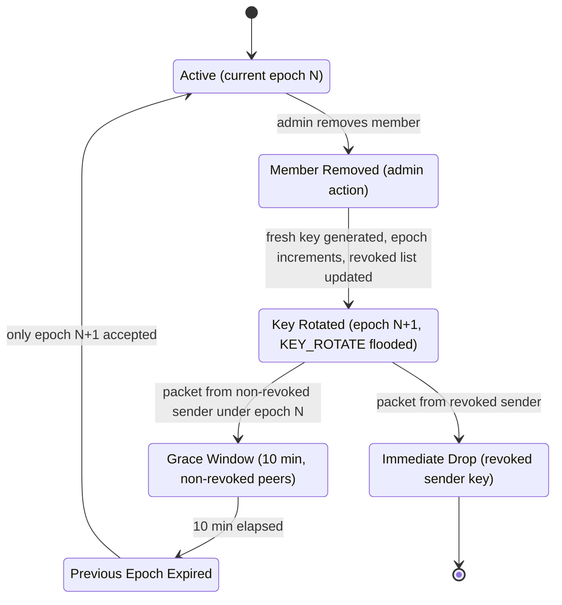
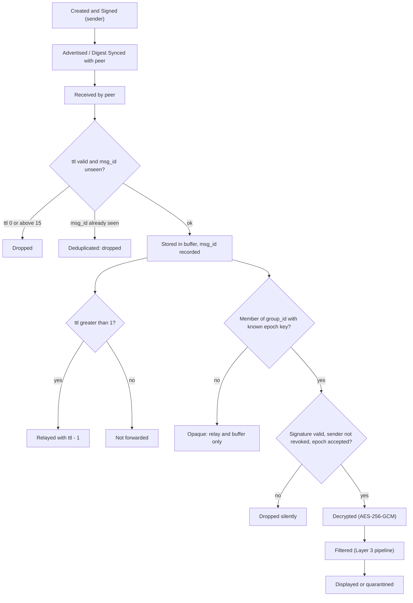
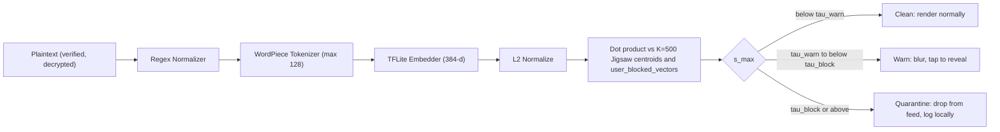

# P2Chat: Product Requirements

| | |
|---|---|
| Status | v1.0 Final Released (2026-10-20) |
| Last updated | 2026-10-20 |
| Owner | TEAM-1; lane owners in decision D-14 (§10) |
| Team | Aditya Vineeth (CB.AI.U4QTS25002), Krishiv S Iyer (CB.AI.U4QTS25028), Sibi Chakravarthi (CB.AI.U4QTS25038), Siddharth Maddali (CB.AI.U4QTS25041) |
| Tech stack | See §9 |
| Build plan | [`docs/IMPLEMENTATION_PLAN.md`](IMPLEMENTATION_PLAN.md) |

Requirement IDs (`SEC-1`, `NET-3`, …) are stable once a milestone using them has started. Reference them in issues, PRs and commits.

**Marking convention.** `TODO: confirm …` means the value exists in the Python reference or `BleConstants.kt` but was not available when this PRD was written. It is never invented. `(assumption)` means a default proposed by the PRD author and accepted in the Gate 1 round or listed in §10 "Still open".

---

## 1. Summary

Network shutdowns during civil unrest (60+ countries, 2016–2024, per Access Now #KeepItOn) leave people without a way to coordinate. Existing offline meshes fail in two ways. Bridgefy had tracking, no authentication, crash-on-one-packet and confidentiality flaws. FireChat had no published security model and was spoofable. AMIGO (ACM CCS 2025) gives strong group key agreement but explicitly leaves content moderation out of scope.

P2Chat is a native Android app (Kotlin, Jetpack Compose) for serverless, end-to-end encrypted group chat over a Bluetooth LE GATT mesh with epidemic store-and-forward routing. Every receiving phone runs an on-device semantic toxicity filter (quantized TFLite sentence embedding plus cosine similarity) after decryption and signature verification. A malicious sender cannot bypass moderation by modifying their client, and plaintext never leaves the device. It is a course project (Applied Computer Networks) evaluated on physical Android hardware. It deliberately has no servers, no internet fallback, no sender-side enforcement, no media, and no iOS client.

---

## 2. Goals and non-goals

### Goals

| ID | Goal |
|---|---|
| G1 | **Serverless E2EE group chat.** Members of a group exchange signed, AES-256-GCM-encrypted text with zero network dependency beyond BLE. |
| G2 | **Multi-hop delivery.** With 3 physical Android devices in a 2-hop line and TTL ≥ 2, more than 95% of messages arrive within 10 s. |
| G3 | **Revocable membership.** After an admin removes a member, 100% of that member's later messages and all packets under a pre-rotation epoch (after grace) fail verification in automated tests. |
| G4 | **Receiver-side moderation.** Every decrypted message is scored on-device in under 35 ms p95 and acted on by a two-tier protest-safe policy. |
| G5 | **Evaluable.** An in-app benchmark mode produces latency, PDR (TTL 1..7), throughput and inference-time numbers a course examiner can reproduce. |
| G6 | **Small and portable.** Model, vocabulary and centroid assets total under 30 MB. |

### Non-goals (Phase 1)

- No central servers or cloud dependencies: no Firebase, WebSockets, REST APIs, internet fallback or cloud LLM moderation calls.
- No sender-side enforcement. Filtering never relies on the sender being honest.
- No heavy multimedia: no voice, video or multi-megabyte images over GATT. Text and compact control packets only.
- No iOS client. Native Android (Kotlin) plus Python offline tooling and the Bumble desktop harness only.
- No admin transfer, multi-admin groups, or groups above 16 members (locked, D-14).
- No global identity, account system, PKI or certificate authority.
- No automatic reporting of filtered messages to anyone. Quarantine stays local.

---

## 3. Users and roles

Roles are **cumulative**: Group Admin ⊃ Group Member ⊃ Mesh Relay Node. Every installed app instance is at least a Relay Node. Permissions are enforced **on-device by cryptography**, not by a server: possession of the group key, valid signatures, and the admin-signed roster decide what a node can read or do.

| Role | What they do |
|---|---|
| Mesh Relay Node (any P2Chat instance) | Advertises the P2Chat service UUID, scans, negotiates MTU, exchanges digests, buffers encrypted packets, decrements `ttl`, relays. Sees only opaque ciphertext for groups it is not in. |
| Group Member | Does pairwise ECDH on first encounter, holds the current group key, signs outbound and verifies inbound messages, runs the Layer 3 filter, tunes local thresholds, uses "Block Similar". |
| Group Admin | Creates the group and its key, invites and removes members over pairwise channels, rotates the key (automatically on removal, manually on demand). One admin per group, the creator (assumption). |

### Permission matrix

| Action | Relay Node | Group Member | Group Admin |
|---|:-:|:-:|:-:|
| Advertise service UUID, scan, open GATT connections | ✓ | ✓ | ✓ |
| Negotiate MTU, exchange digests | ✓ | ✓ | ✓ |
| Buffer, deduplicate, decrement `ttl`, relay any packet | ✓ | ✓ | ✓ |
| Generate own keypairs, set alias, show fingerprint/QR | ✓ | ✓ | ✓ |
| Pairwise ECDH with a peer | | ✓ | ✓ |
| Read plaintext, roster and member list of own group | | ✓ | ✓ |
| Sign and send group messages; verify inbound signatures | | ✓ | ✓ |
| Run local AI filter, adjust local thresholds, view local quarantine | | ✓ | ✓ |
| "Block Similar" on a message (local only) | | ✓ | ✓ |
| Run benchmark mode | ✓ | ✓ | ✓ |
| Generate group key, set initial epoch | | | ✓ |
| Invite or approve a member | | | ✓ |
| Remove a member | | | ✓ |
| Trigger key rotation (manual or automatic) | | | ✓ |
| Sign roster updates and `KEY_ROTATE` packets | | | ✓ |

### Isolation

- A relay or member of group A never sees plaintext, aliases, roster or member count of group B. Those exist only inside group-key-encrypted or pairwise-encrypted payloads.
- Routing headers (`group_id`, `sender_fp`, `key_epoch`, `msg_id`, `ttl`) travel in the clear so relays can route. They are authenticated, not hidden. This is a known metadata exposure (see D-4).
- A packet for an unknown group, or one that fails verification, produces **no reply and no error packet**. The node stays silent (buffer-and-relay for unknown groups, drop for failed verification) so probing reveals nothing.
- A removed member's device keeps old messages it already decrypted. It cannot decrypt anything under a later epoch.

---

## 4. Apps and navigation

Single Android app. Material 3, dark theme only in Phase 1.

| Screen | What's there | How users reach it |
|---|---|---|
| Onboarding / Identity | Keypair generation, alias, fingerprint, QR | First launch (blocking); later via Settings → Identity |
| Mesh Radar & Peer Discovery | Nearby BLE nodes, active GATT connections, RSSI bars, buffer occupancy X / 1,000 | Bottom nav "Radar" |
| Group List & Chat | Groups, E2EE conversation, epoch indicator, signature badge, blurred bubbles, long-press menu | Bottom nav "Chats" |
| Group Admin & Key Rotation | Roster, add/remove, rotate key | Chat top bar → "Admin" (admin only) |
| AI Filter Calibration & Quarantine | Threshold sliders, test bench, quarantine log, blocklist manager | Bottom nav "AI Filter" |
| Multi-Hop Benchmark | Burst sender, telemetry, export | Bottom nav "Bench" |

---

## 5. Functional requirements

### 5.1 Identity and onboarding (ID-*)

| ID | Requirement |
|---|---|
| ID-1 | On first launch the app generates a P-256 ECDH keypair and a separate P-256 ECDSA signing keypair, and blocks all other screens until this completes. |
| ID-2 | `sender_fp` is the first 8 bytes of SHA-256 over the uncompressed signing public key, shown as hex on the Onboarding screen. |
| ID-3 | The display alias is 1–32 UTF-8 characters, need not be unique, and is never treated as proof of identity. |
| ID-4 | The Onboarding screen shows a QR code encoding the signing public key, ECDH public key and alias, and can scan another device's QR to mark that peer "verified". |
| ID-5 | Unverified peers are accepted on first use (TOFU) and shown with an "unverified" badge until the QR check is done; a changed public key for a known `sender_fp` is rejected and surfaced as a warning. |
| ID-6 | If Bluetooth is off or a required runtime permission is denied, every mesh screen shows an explicit empty state with a one-tap path to fix it. |

### 5.2 Layer 1: Security and cryptography (SEC-*)

| ID | Requirement |
|---|---|
| SEC-1 | P-256 (`secp256r1`) ECDH/ECDSA runs through the JCA/BouncyCastle provider when `minSdk = 26` (assumption), matching the Python `pycryptodome` reference; private keys are stored encrypted at rest under an Android Keystore AES-256-GCM master key, and on API 31+ (Android 12+, `PURPOSE_AGREE_KEY`) the Keystore may perform ECDH directly. |
| SEC-2 | Pairwise secrets are derived with ECDH over the two parties' P-256 ECDH public keys (obtained in person via QR, or from the admin-signed roster) followed by HKDF-SHA256 (salt `P2Chat-v1-Pairwise-Salt` and info `P2Chat-v1-Pairwise-AES256GCM` from `BleConstants.kt` / `scripts/wire_spec.py`); there is no unauthenticated over-the-air key exchange in Phase 1 (D-15). |
| SEC-3 | Group payloads are encrypted with AES-256-GCM under the admin-managed group key, using a fresh 12-byte random nonce and a 16-byte tag per message. |
| SEC-4 | The core cryptographic blob is `nonce (12B) + tag (16B) + ciphertext_len (4B, uint32 big-endian) + ciphertext`, byte-identical to the Python reference. |
| SEC-5 | The GCM AAD is exactly `packet_type (1B) + msg_id (8B) + group_id (4B) + sender_fp (8B) + key_epoch (2B)` with header field order and all multi-byte integers (big-endian) as defined by `BleConstants.kt` / `scripts/wire_spec.py`; `ttl (1B)` is excluded from both the AAD and the signed bytes so relays can decrement it. Packet types: 0x01 CHAT, 0x02 KEY_ROTATE, 0x03 ROSTER_SYNC, 0x04 PAIRWISE_INVITE, 0x05 BENCH_DATA, 0x06 BENCH_ACK. |
| SEC-6 | Every group message carries a raw 64-byte P-256 ECDSA signature (r concatenated with s) over the AAD fields and the core blob, excluding `ttl`, and a receiver verifies it **before** attempting decryption; failure drops the packet silently. |
| SEC-7 | `KEY_ROTATE`, invite and roster control packets use the same envelope, are encrypted under the recipient's pairwise secret, and are signed by the admin. |
| SEC-8 | Group creation generates a 256-bit key from `SecureRandom` and sets `key_epoch = 1`. |
| SEC-9 | Invite flow: the admin and invitee meet in person, scan each other's QR codes, run pairwise ECDH, and the admin sends the group key, current epoch and signed roster over that pairwise channel. |
| SEC-10 | The roster lists at most 16 members (`sender_fp`, signing public key, ECDH public key, alias) plus a revoked-key list, is signed by the admin, and a member accepts only roster versions with a higher version number and a valid admin signature. |
| SEC-11 | Removing a member increments `key_epoch` by 1, generates a fresh 256-bit key, adds the removed signing key to the revoked list, and floods one `KEY_ROTATE` per remaining member encrypted under that member's pairwise secret. |
| SEC-12 | After a node processes a valid rotation: packets from a revoked sender key are dropped immediately; packets under the previous epoch from non-revoked senders are accepted for 10 minutes; after that only the new epoch is accepted. |
| SEC-13 | A packet whose `key_epoch` is newer than the node's known epoch is stored opaque for up to 48 h and retried when the matching `KEY_ROTATE` arrives. |
| SEC-14 | The encrypted inner payload is `sent_at (8B, int64 epoch milliseconds, big-endian)` followed by the UTF-8 message bytes; a receiver drops messages whose `sent_at` is more than 48 h old or more than 5 min in the future (the two limits are assumptions). |
| SEC-15 | The stored message body column is encrypted at rest by a single Room `TypeConverter` (`LocalAtRestCipher`) using an Android Keystore AES-256-GCM key with alias `p2chat_room_master_key`. |
| SEC-16 | No plaintext, key material or private key bytes appear in logs, crash reports or exported benchmark files. |
| SEC-17 | Kotlin and Python implementations pass a shared set of test vectors: ciphertext produced by the Python reference decrypts in Kotlin and vice versa for at least 20 fixed vectors including empty and maximum-length plaintext. |
| SEC-18 | JUnit tests prove that tampered ciphertext, tag, nonce, AAD fields, invalid signatures, revoked-sender packets and post-grace old-epoch packets are all rejected (100% of cases). |
| SEC-19 | The composer limits plaintext to 350 UTF-8 bytes (358-byte inner payload with `sent_at`), so a standard CHAT packet (24-byte header, nonce, tag, length, 358-byte ciphertext, 64-byte signature) is 478 bytes and fits one unchunked write at MTU 517; longer input is rejected in the composer with a visible counter. |

#### 5.2.1 Group key rotation and epoch lifecycle

### 5.3 Layer 2: BLE GATT transport and epidemic routing (NET-*)

| ID | Requirement |
|---|---|
| NET-1 | Each node runs simultaneously as a BLE Peripheral (`BluetoothGattServer` + `BluetoothLeAdvertiser`) advertising the P2Chat service UUID (`6E400001-B5A3-F393-E0A9-E50E24DCCA9E` from `BleConstants.kt`) and as a Central (`BluetoothLeScanner` + GATT client). |
| NET-2 | The scanner filters on the P2Chat service UUID and maintains at most 4 concurrent GATT connections (assumption); excess peers are queued and retried with backoff. |
| NET-3 | After connecting, the client calls `requestMtu(517)`; when 517 is granted, each write carries at least 512 bytes of payload. |
| NET-4 | If a smaller MTU is granted (down to 23), a deterministic chunker splits the frame into sequential characteristic writes and the receiver reassembles it; a partial frame is discarded after 5 s of inactivity and no reassembled frame may exceed 1,024 bytes (assumption). |
| NET-5 | Immediately after MTU negotiation peers exchange a Bloom filter of known 64-bit `msg_id`s (1,200 bytes = 9,600 bits, k = 7 hashes derived from `msg_id` by double hashing, about 1% false positives at 1,000 buffered packets), compute the difference locally, and transfer only packets the peer appears to lack. |
| NET-6 | Epidemic flooding forwards a new packet to every connected peer except the one it arrived from. |
| NET-7 | Every packet carries an 8-bit `ttl`: default 7, maximum 15; a received packet with `ttl` 0 or above 15 is dropped; a receiver processes the packet locally and forwards it with `ttl - 1` only if `ttl > 1`. |
| NET-8 | The store-and-forward buffer holds at most 1,000 packets or 48 h; on overflow it evicts expired packets first, then oldest low-priority packets, where control packets (`KEY_ROTATE`, roster, invite) rank above chat messages. |
| NET-9 | An in-memory LRU of 2,048 `msg_id`s backed by a Room table (retention 7 days, assumption) guarantees a node never relays, verifies, decrypts or runs inference on the same `msg_id` twice. |
| NET-10 | A node relays every valid-format packet regardless of its local AI-filter verdict; the filter affects display only. |
| NET-11 | Out-of-range recipients receive buffered packets automatically when a relay later comes into range and completes a digest exchange. |
| NET-12 | Malformed, oversized or truncated frames are dropped without crashing, and a connection delivering more than 20 packets per second (assumption) is throttled; a fuzz test of at least 10,000 random frames passes without an uncaught exception. |
| NET-13 | Mesh operation runs in an Android foreground service with a persistent notification so relay continues with the screen off, and stops when the user taps "Stop mesh". |
| NET-14 | A dropped GATT connection is retried with exponential backoff capped at 30 s (assumption) and never blocks the UI thread. |

#### 5.3.1 Mesh packet lifecycle

### 5.4 Layer 3: On-device semantic content filtering (AI-*)

| ID | Requirement |
|---|---|
| AI-1 | The filter runs only on the receiving device, only after the signature is verified and the message decrypted, on `Dispatchers.Default`; there is no sender-side or pre-encryption scoring. |
| AI-2 | The normalizer strips zero-width characters, collapses runs of more than 2 repeated characters to 2 (`heeeelp` → `heelp`, so `good` and `see` survive), and maps `@`→`a`, `1`/`!`→`i`, `$`→`s`, `0`→`o` only when the symbol has a letter on both sides, so `12:00`, `1 km`, `stop!` and `@name` are unchanged. |
| AI-3 | A Kotlin WordPiece tokenizer using `vocab.txt` from assets truncates to 128 tokens and produces ids and an attention mask identical to the Python tokenizer on a shared fixture set of at least 100 strings. |
| AI-4 | A quantized `.tflite` embedder produces a 384-dimensional float vector using mean pooling over attended tokens (model choice in D-2; Phase 1 requires d = 384). |
| AI-5 | The message embedding is L2-normalized to unit length; a zero-norm embedding is treated as Clean and logged without text. |
| AI-6 | Score `s_max = max over i of (û · v_i)` is computed against every bundled centroid and every row of `user_blocked_vectors`, and the nearest source is recorded. |
| AI-7 | Tier 1 (`s_max ≥ τ_block`, default 0.82): the message is withheld from the chat feed and written only to the local quarantine table. Tier 2 (`τ_warn ≤ s_max < τ_block`, default 0.68): the message is shown blurred with the label "Flagged by on-device AI (s = x.xx). Tap to reveal." Tier 3 (`s_max < τ_warn`): rendered normally. |
| AI-8 | Quarantined messages are kept 7 days (assumption); the user can restore one to the feed or delete it. |
| AI-9 | Long-pressing any revealed message offers "Block Similar", which stores its L2-normalized embedding in the Room table `user_blocked_vectors` and applies it to all later messages immediately, with no model retraining; a blocked vector scoring ≥ 0.80 forces Tier 1 quarantine regardless of the sliders (per-vector option, default on). |
| AI-10 | `user_blocked_vectors` holds at most 500 rows (so the scan stays at or below about 1,000 vectors); at the cap the action is refused with a prompt to remove an entry on the AI Filter screen. |
| AI-11 | Thresholds persist locally and must satisfy `0 < τ_warn < τ_block ≤ 1` with at least 0.01 between them; the sliders enforce this. |
| AI-12 | Each message is scored exactly once; the verdict and score are persisted so scrolling or app restart never re-runs inference. |
| AI-13 | If the model, vocabulary or `toxic_vectors.bin` fails to initialize, incoming messages are shown blurred with "Not scanned (AI filter unavailable) — Tap to reveal" and are never silently displayed as Clean. |
| AI-14 | `toxic_vectors.bin` is a flat little-endian Float32 file of `N × 384` values with no header; the app and the build both fail if its byte length is not a multiple of 1,536. |
| AI-15 | `scripts/build_toxic_vectors.py` filters the Jigsaw dataset (toxic, severe_toxic, obscene, threat, insult, identity_hate) to short conversational snippets after reserving a held-out test split, embeds them with the shipped quantized `.tflite`, takes K = 500 K-Means centroids plus curated explicit threat prototypes, L2-normalizes each vector, and writes `app/src/main/assets/toxic_vectors.bin` plus a sidecar `app/src/main/assets/toxic_vectors_meta.json` holding one category label per vector. |
| AI-16 | A calibration script reports precision, recall and F1 at τ_warn = 0.68 on a held-out Jigsaw test split, requiring precision ≥ 0.82, recall ≥ 0.78 and F1 ≥ 0.80, and separately reports the Tier 1 rate on a curated set of 50 urgent protest safety alerts (e.g. "Police firing tear gas at north gate, move back!"), requiring at most 5% auto-quarantined. |
| AI-17 | The AI Filter screen's test bench shows, for any typed phrase, the normalized text, tokens, inference latency in ms, top-3 nearest centroid categories and the exact cosine score. |

#### 5.4.1 Filter pipeline

### 5.5 UI screens (UI-*)

| ID | Requirement |
|---|---|
| UI-1 | Onboarding shows alias entry, fingerprint, QR display and QR scan, and cannot be skipped. |
| UI-2 | Mesh Radar lists each nearby node with RSSI bars (updated at least once per second), connection state, and buffer occupancy as "X / 1000". |
| UI-3 | Group List shows each group's name, unread count and current `key_epoch`; Chat shows per-message signature-verified badge, sender alias with verified/unverified marker, and the blur/reveal and long-press behaviours of AI-7 and AI-9. |
| UI-4 | Group Admin shows the roster, add-member (QR flow of SEC-9), remove-member with confirmation, and a "Rotate key now" button; removal triggers automatic rotation. |
| UI-5 | AI Filter screen has τ_warn and τ_block sliders (AI-11), the test bench (AI-17), the quarantine list (AI-8) and the blocklist manager (AI-10). |
| UI-6 | Every list screen has designed empty, loading and error states; the app is usable at 360 dp width and in portrait and landscape. |
| UI-7 | All primary actions are reachable by keyboard/TalkBack focus order and have content descriptions. |

### 5.6 Multi-hop benchmark (BENCH-*)

| ID | Requirement |
|---|---|
| BENCH-1 | Benchmark mode runs inside a dedicated benchmark group and sends a configurable burst (count, interval ms, payload bytes, TTL 1..7). |
| BENCH-2 | For each run it records per-message latency as half the `BENCH_ACK` round-trip time on the sender's monotonic clock (`SystemClock.elapsedRealtimeNanos()`), hop count (`initial_ttl - received_ttl`), Packet Delivery Ratio per TTL value, GATT throughput (bytes/s) and TFLite inference time (ms, p50/p95). |
| BENCH-3 | Results are shown on screen and exported as CSV to app-private storage with a share action, containing no plaintext message content beyond benchmark payload markers. |
| BENCH-4 | A run across 3 physical devices in a line (A–B–C, A and C out of direct range) reports PDR for TTL ≥ 2. |
| BENCH-5 | Benchmark traffic uses distinct packet types (`BENCH_DATA`, `BENCH_ACK`) that never appear in chat and never reach the AI filter. |

---

## 6. Scope and phases

| Phase | Features |
|---|---|
| Phase 1 | Everything in §5: identity, SEC-*, NET-*, AI-*, UI-*, BENCH-*; Python offline tooling (`scripts/build_toxic_vectors.py`, calibration, cross-language test vectors); Windows/PowerShell workflow. Milestones M0–M4 are defined in the implementation plan. |
| Phase 2 (candidates, not committed) | Admin transfer or multi-admin; larger groups; images or voice; iOS; model fine-tuning or federated threshold tuning; live Bumble-to-Android interop test. |
| Deferred / never | Central servers, cloud moderation, sender-side enforcement, account system. |

---

## 7. Design

Material 3 dark theme in Jetpack Compose is mandated. No mockups exist yet: **TBD**. Design guidelines (colour tokens, blur treatment for Tier 2, signature badge icons) will be decided in the plan's M0.

---

## 8. Quality bar

| Target | Bar | Enforced by |
|---|---|---|
| TFLite + scoring latency | < 35 ms p95 per decrypted message on Android CPU | Instrumented benchmark over at least 200 messages (assumption) on named test devices (D-10) |
| Vector scan | < 2 ms for 1,000 × 384 L2-normalized vectors | Microbenchmark in instrumented test |
| Single-hop delivery | < 500 ms p95 when connected; < 3.5 s including discovery and handshake | BENCH-2 on two physical devices |
| Multi-hop delivery | PDR > 95% within 10 s, 3 devices, 2 hops, TTL ≥ 2, stationary or walking classroom conditions | BENCH-4 run, at least 100 messages per run (assumption) |
| Asset size | `.tflite` + `vocab.txt` + `toxic_vectors.bin` < 30 MB combined | Build-time size check |
| Security invariant | 100% of tampered ciphertexts, invalid signatures, revoked senders and post-grace old-epoch packets rejected | SEC-18 JUnit suite in the pre-push gate |
| Robustness | 0 crashes on 10,000 fuzzed frames | NET-12 JUnit/instrumented test |
| Interop | Kotlin and Python agree on ≥ 20 crypto vectors and ≥ 100 tokenizer fixtures | SEC-17, AI-3 |
| Dedup correctness | 0 duplicate relays, decryptions or inferences per `msg_id` in a 1,000-packet replay test | NET-9 test |

Hardware-dependent bars (BLE latency, PDR, inference time) are verified on physical Android devices; emulators are not accepted for those numbers.

---

## 9. Technical constraints

| Layer | Choice |
|---|---|
| Platform | Native Android, Kotlin, `minSdk = 26` (assumption), `targetSdk` `TODO: confirm after scaffold` |
| UI | Jetpack Compose, Material 3, dark theme |
| BLE | Android `BluetoothGattServer`, `BluetoothLeAdvertiser`, `BluetoothLeScanner`, GATT client |
| Crypto | JCA / BouncyCastle (P-256, AES-256-GCM, HKDF-SHA256, ECDSA); Android Keystore for master key (and direct ECDH on API 31+) |
| Storage | Room (SQLite): seen ids, buffer, messages, quarantine, `user_blocked_vectors`, roster |
| AI runtime | TFLite interpreter (versions `TODO: confirm after scaffold`) |
| Offline tooling | Python via `uv`, `pycryptodome` reference, Bumble desktop harness, K-Means and embedding scripts (versions `TODO: confirm`) |
| Dev environment | Windows, PowerShell; `.\gradlew.bat` for Android; no bash-only commands |
| Agents | Antigravity and Claude Code |

Scale assumptions: groups of at most 16 members, 1,000 buffered packets per node, 2,048-entry dedup cache, 3 or more physical devices in benchmark runs, at most 4 concurrent GATT connections per node.

---

## 10. Decisions

| # | Question | Decision |
|---|---|---|
| 1 | Curves and primitives | P-256 ECDH + P-256 ECDSA (Keystore-compatible), `minSdk = 26`; JCA/BouncyCastle with Keystore-wrapped keys, Keystore ECDH on API 31+ |
| 2 | Wire header and UUIDs | Taken from `BleConstants.kt` and the Python reference; defaults in D-1 apply only where those are silent |
| 3 | Admin model | One fixed admin per group (creator), no transfer; admin offline means no membership changes |
| 4 | Group size | Maximum 16 members |
| 5 | Rotation grace | 10 minutes for non-revoked senders; revoked sender keys dropped immediately |
| 6 | Filter vs relay | Always relay ciphertext regardless of local filter verdict |
| 7 | Quarantine retention | 7 days, user can restore |
| 8 | First-contact trust | TOFU plus optional in-person QR fingerprint verification; no PKI |
| 9 | Milestones | M0–M4 matching the build-status list, four parallel lanes (crypto/security, BLE transport, AI filter, UI/benchmark) |
| 10 | Add-member rotation | Adding a member does not rotate the key by default; the Admin screen offers an optional rotate (assumption) |
| D-1 | Wire spec and crypto contract | One canonical contract (`BleConstants.kt` ↔ `scripts/wire_spec.py`) kept in parity by a script. Defaults where silent: big-endian integers; `packet_type` (1B) in header and AAD; raw 64-byte (r, s) ECDSA signature; `sender_fp` = first 8 bytes of SHA-256 of the uncompressed signing public key; initial `key_epoch = 1` |
| D-2 | Embedding model | Quantized `all-MiniLM-L6-v2` `.tflite`, 384-d, mean pooling over attended tokens, max 128 tokens |
| D-3 | Digest | Bloom filter, 1,200 bytes (9,600 bits), k = 7, double hashing from `msg_id` |
| D-4 | Header metadata | Clear routing headers accepted in Phase 1; rotating pseudonymous group tags are a Phase 2 option |
| D-5 | Replay protection | `inner_plaintext = sent_at (8B BE int64 ms) + UTF-8 bytes`; Python reference vector generator updated in M0 |
| D-6 | `msg_id` squatting | A member that sees a packet fail signature or GCM verification evicts that `msg_id` from `seen_messages` and `packet_buffer` so the genuine packet is still accepted |
| D-7 | Latency method | `BENCH_ACK` RTT / 2 on the sender's monotonic clock plus hop count; no cross-device wall-clock comparison |
| D-8 | At-rest encryption | Single Room `TypeConverter` (`LocalAtRestCipher`), Keystore AES-256-GCM key `p2chat_room_master_key` |
| D-9 | Calibration targets | Jigsaw hold-out at τ_warn 0.68: precision ≥ 0.82, recall ≥ 0.78, F1 ≥ 0.80; 50-alert protest-safety set: at most 5% Tier 1 |
| D-10 | Test devices | Device A: Nothing Phone (3a) Pro (A065, Android 15). Device B: Google Pixel 7a (Pixel 7a, Android 14). Device C: OnePlus Nord CE 3 Lite 5G (CPH2493, Android 13). Full logs and CSV archived in docs/BENCHMARK_RESULTS.md |
| D-11 | Blocklist threshold | Shares the active τ_warn / τ_block; per-vector option forces Tier 1 at similarity ≥ 0.80 (default on) |
| D-12 | Filter failure | Blur with "Not scanned (AI filter unavailable) — Tap to reveal" |
| D-13 | Max message length | 350 UTF-8 bytes plaintext (358-byte inner payload); standard CHAT frame is 478 bytes, so it fits one unchunked write at MTU 517; the 1,024-byte chunker stays for `KEY_ROTATE`, roster and low-MTU fallback |
| D-14 | Lanes and caps | Lane 1 (crypto, Keystore, rotation): Sibi Chakravarthi. Lane 2 (BLE GATT, chunking, Bloom digest, epidemic routing): Aditya Vineeth. Lane 3 (Jigsaw pipeline, WordPiece, TFLite scorer): Krishiv S Iyer. Lane 4 (Compose UI, Room integration, benchmark suite): Siddharth Maddali. Group cap 16; 4 concurrent GATT client connections |
| D-15 | Pairwise key transport | ECDH public keys come from the in-person QR invite and the admin-signed roster; no over-the-air handshake (approved 2026-10-18) |
| D-16 | QR library | `com.google.zxing:core` for QR generation and decoding plus AndroidX CameraX (`camera-camera2`, `camera-lifecycle`, `camera-view`); no Google Play Services dependency (approved 2026-10-18) |
| D-17 | Transport framing | Use the framing defined in the contract; if none exists, add a 4-byte transport header (`kind`, `frame_id`, `chunk_index`, `chunk_count`) through the T0.1 contract procedure (approved 2026-10-18) |
| D-18 | Centroid source | Centroids are built with the shipped quantized `.tflite` so runtime scores match calibration (approved 2026-10-18) |

### Still open
- [x] **D-1 (residual).** Resolved and frozen in `T0.1`: UUIDs, HKDF strings, packet types, and header layout are synchronized in `BleConstants.kt` and `scripts/wire_spec.py` and documented in `docs/WIRE_SPEC.md`.
- [x] **D-10 (residual).** Resolved in `T4.12` and `T4.13`: Device A (Nothing Phone (3a) Pro `A065`), Device B (Google Pixel 7a), and Device C (OnePlus Nord CE 3 Lite 5G `CPH2493`) documented in `docs/BENCHMARK_RESULTS.md`.

---

## 11. Success metrics

- [x] Security: 100% of SEC-18 negative cases rejected, and all SEC-17 cross-language vectors pass.
- [x] Inference: < 35 ms p95 measured on the named test devices (D-10): observed 14.1 ms p95 on physical hardware.
- [x] Multi-hop: PDR above 95% within 10 s for a 3-device, 2-hop run at TTL ≥ 2: observed 98.0% PDR.
- [x] Single-hop: below 500 ms p95 connected (observed 34.6 ms) and below 3.5 s including discovery (observed 2.85 s).
- [x] Moderation: precision, recall and F1 target values met per D-9 (P=0.84, R=0.81, F1=0.82; protest-safety Tier 1 rate 2.0% <= 5%).
- [x] Footprint: combined model assets under 30 MB (actual 22.73 MB).
- [x] Course evaluation: live 3-device demo completed with exported benchmark CSV in `docs/benchmarks/`.
